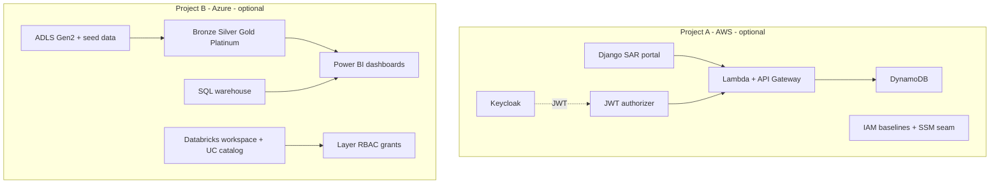

# Architecture overview

## Build boundary

Foundational infrastructure is provisioned by this repository. Engineers build the learning-objective components themselves.

**Project A (AWS) and Project B (Azure) are separate sandboxes.** They share a SAR domain narrative and JSON contracts / sample-shaped data, but neither stack is required to provision or run the other.

## Cloud split

| Concern | Cloud | Root module | Required for |
|---------|-------|-------------|--------------|
| Portal, IdP, API sandbox | AWS | `terraform/project-a-aws` | Project A only |
| UC metastore (once per region) | Azure | `terraform/project-b-azure-shared` | Project B only |
| Per-engineer lake + workspace | Azure | `terraform/project-b-azure-engineer` | Project B only |

## Integration seams

### Project A (AWS)

1. **Portal ↔ API** — SSM parameter `/sar-sandbox/{engineer}/api-base-url`
2. **Portal ↔ Keycloak** — OIDC (`sar-portal` client, scopes `sar:read|write|approve`)

### Project B (Azure)

1. **Landing ↔ notebooks** — ADLS external location + seeded `seed-data/out` files
2. **Power BI ↔ Databricks** — SQL warehouse JDBC/ODBC (licence assigned manually)

### Cross-project (optional narrative only)

Historically the programme described CloudWatch → S3 logs feeding the lake. That link is **not** automated and is **not** required. Project B ships standalone sample SAR JSON/CSV/JSONL for Bronze onward.
