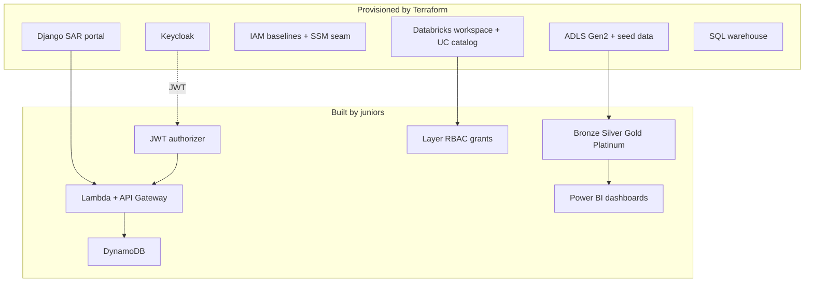

# Architecture overview

## Build boundary

Foundational infrastructure is provisioned by this repository. Engineers build the learning-objective components themselves.

## Cloud split

| Concern | Cloud | Root module |
|---------|-------|-------------|
| Portal, IdP, API sandbox | AWS | `terraform/project-a-aws` |
| UC metastore (once per region) | Azure | `terraform/project-b-azure-shared` |
| Per-engineer lake + workspace | Azure | `terraform/project-b-azure-engineer` |

## Integration seams

1. **Portal ↔ API** — SSM parameter `/sar-sandbox/{engineer}/api-base-url`
2. **Portal ↔ Keycloak** — OIDC (`sar-portal` client, scopes `sar:read|write|approve`)
3. **Project A → Project B** — CloudWatch → S3 log archive (export) + seeded historical SAR files in ADLS landing
4. **Power BI ↔ Databricks** — SQL warehouse JDBC/ODBC (licence assigned manually)
