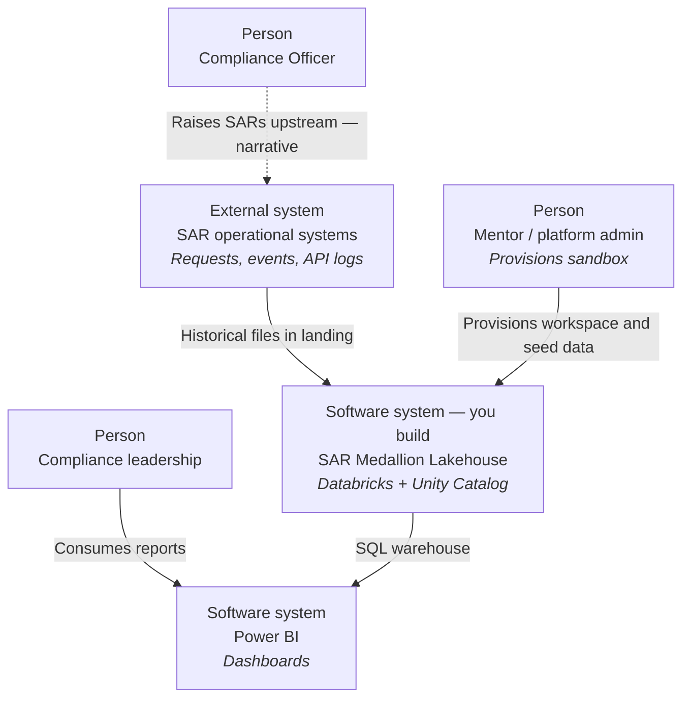
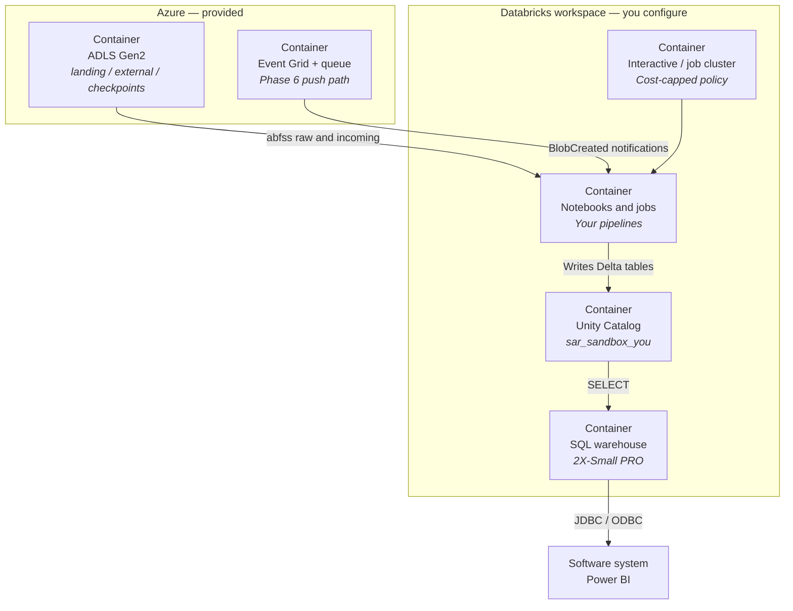
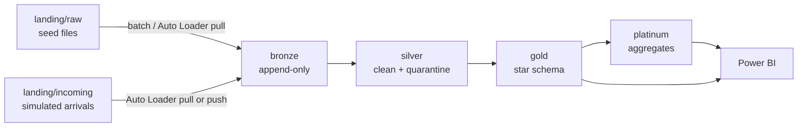
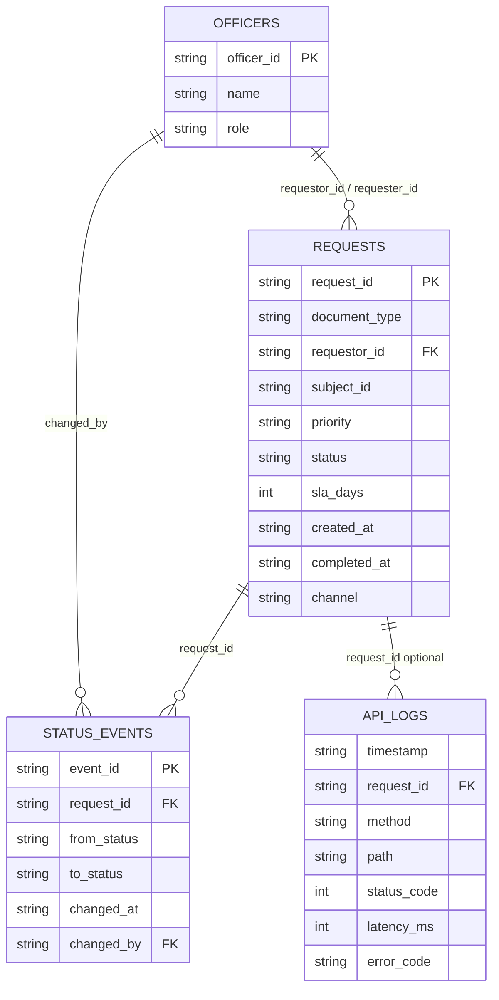

# Project B — Medallion data lake exercises

Phased learning path for the **Azure Databricks Medallion Data Lake & SAR Reporting** sandbox. Read the [engineer runbook](../runbook.md) for environment facts, then work these phases with your mentor.

You do **not** need Project A (AWS). Landing data is pre-seeded. Your job is to design and build the analytical pipeline on top.

## What this project is about

Compliance officers raise **Subject Access Requests (SARs)** — requests for a person's data in a specific document type (profile summary, activity report, or consent log). Operational systems produce request records, status-change events, and API access logs. Leadership needs answers about SLAs, officer workload, and system reliability.

You will turn raw files in cloud storage into a governed, queryable lakehouse that Power BI can consume — using the same patterns used in production data platforms.

## What has already been built for you

Your mentor provisioned a personal sandbox. You do **not** create these:

| Asset | What it is |
|-------|------------|
| ADLS Gen2 storage | Containers `landing`, `external`, `checkpoints` |
| Seeded landing data | Historical SAR JSON/CSV/JSONL under `raw/` (includes deliberate quality issues) |
| Databricks Premium workspace | Assigned to a shared Unity Catalog metastore |
| Catalog `sar_sandbox_<you>` | Empty of medallion schemas — **you** create `bronze`, `silver`, `gold`, `platinum` |
| External locations | Landing, external, and checkpoints (readable/writable via Unity Catalog) |
| SQL warehouse | 2X-Small PRO, auto-stops after 10 minutes, starts on first query |
| Cost-capped cluster policy | Single-node only, max 4 DBU/hour — you create clusters **only** under this policy |
| Groups | `sar-<you>-data-engineers`, `sar-<you>-analysts`, `sar-<you>-report-authors` |
| Event notification (Phase 6) | Storage queue + Event Grid for push (file-notification) ingestion |

Getting started:

```bash
terraform -chdir=terraform/project-b-azure-engineer workspace select <you>
terraform -chdir=terraform/project-b-azure-engineer output
```

Open `databricks_workspace_url`. Import starter notebooks from [`project-deployments/project-b/notebooks/`](../../../../project-deployments/project-b/notebooks/).

## How to work these phases

- **Follow the order.** Each phase assumes the previous layer exists.
- **Concept first, then build.** Read the theory section before coding.
- **Treat each checklist as a checkpoint.** Walk **You are done when** with your mentor before moving on.
- **Phase 2 and Phase 6 are the largest.** Split them into layers; do not attempt the whole phase in one sitting.
- **Stretch challenges are for you to plan.** Requirements and acceptance criteria only — research and design, then implement.
- **Keep naming consistent** from Gold onward: schemas `bronze` / `silver` / `gold` / `platinum`; tables `fact_*`, `dim_*`, `agg_*`; columns `snake_case`.

## Phases at a glance

| Phase | Focus | What you build | What you learn | Done signal |
|-------|-------|----------------|----------------|-------------|
| **[1 — Bronze ingestion](./phase-1-bronze-ingestion.md)** | Land raw data unchanged | Append-only Delta tables + load metadata | Medallion, append-only, idempotency, schema-on-read | Bronze tables; second run does not double rows |
| **[2 — Silver cleansing & quality](./phase-2-silver-quality.md)** | Make data trustworthy | Clean tables + quarantine / exceptions | Quality dimensions, quarantine, schema drift, RI | Quarantine with reason codes; clean Silver |
| **[3 — Gold dimensional model](./phase-3-gold-dimensional-model.md)** | Model for analytics | Kimball star schema (facts + dims) | Grain, surrogate keys, conformed dims | Star schema answers business questions by join |
| **[4 — Platinum business logic](./phase-4-platinum-business-logic.md)** | Serve decision-makers | Aggregates + Power BI | Serving layer, pre-aggregation, BI | Scorecard tables; dashboard connected |
| **[5 — Governance & access](./phase-5-governance-rbac.md)** | Least privilege | Schema/table grants + evidence | Unity Catalog RBAC, ownership | Analysts cannot read bronze/silver |
| **[6 — Streaming & near-real-time](./phase-6-streaming-near-real-time.md)** | Keep the lake fresh | Pull vs push Auto Loader; streaming medallion | Micro-batch, event-driven, cost of NRT | Comparison table + freshness SLA design note |

## Architecture — C1 System Context



## Architecture — C2 Containers



## Medallion flow (including Phase 6 overlay)



## Test data — where it lives and how you use it

### Location

Files live under the **landing** external location:

```text
abfss://landing@<storage_account>.dfs.core.windows.net/raw/...
```

Discover the URI:

```bash
terraform -chdir=terraform/project-b-azure-engineer output -raw landing_external_location
```

In a notebook (after attaching a cluster under your cost-capped policy):

```python
dbutils.fs.ls("abfss://landing@<storage_account>.dfs.core.windows.net/raw/")
```

Or in SQL: `LIST 'abfss://landing@.../raw/';`

### What was seeded

| Path under `raw/` | Format | Approx. rows | Role |
|-------------------|--------|--------------|------|
| `sar_requests/requests_2024.json` | JSON array | 120 | SAR request headers |
| `sar_requests/requests_2024_tail_truncated.json` | Broken JSON | — | Corrupt-file exercise |
| `events/status_events.csv` | CSV | 102 | Status transitions |
| `logs/api_access.jsonl` | JSONL | 200 | API access / errors |
| `reference/officers.csv` | CSV | 4 | Officer dimension source |
| `manifest.json` | JSON | — | Generator metadata |

### Important: the seed corpus is static

`make seed-data` always uses `--seed 42`. Terraform uploads the **same six paths** every time. There is **no** date partitioning and **no** automatic arrival of new files.

**Consequence for Auto Loader:** Auto Loader deduplicates by **file path**. Overwriting `requests_2024.json` in place does **not** reprocess the file. If you “prove” incremental load only by re-running against the same paths, you may see zero new files and think the pipeline works when it simply had nothing to do.

How these exercises use the data:

| Mode | When | What you do |
|------|------|-------------|
| Full batch | Phases 2–5 | Read all `raw/` files once; frozen corpus = comparable mentor checkpoints |
| Derived micro-batches | Phase 1 guided | Slice requests by `created_at` month and load month-by-month |
| Simulated arrivals | Phase 1 stretch, Phase 6 | Run `99_simulate_arrivals.py` to write **new paths** under `incoming/batch=<timestamp>/` |
| Change Data Feed | Phase 3+ | Incremental Gold from changes to *your* Silver tables |

Regenerate locally (mentor/platform only, then re-apply): `make seed-data` then `make apply-b` — blobs refresh when `content_md5` changes.

### Source data relationships



Some rows intentionally violate these relationships — discovering and handling that is Phase 2.

## Compute reality (read this before opening a cluster)

| Resource | Constraint | Why it matters |
|----------|------------|----------------|
| Interactive / job cluster | Single-node (`num_workers = 0`), `Standard_DS3_v2`, ≤ 4 DBU/hour, auto-terminate 10–20 min | You cannot create unrestricted clusters |
| SQL warehouse | 2X-Small PRO, `min_num_clusters = 0`, auto-stop 10 min | First query wakes it (cold start); serverless is **off** |
| Pipelines | Notebooks and Jobs | Not Delta Live Tables / serverless streaming tables or MVs |

A **continuously running** stream never goes idle, so auto-termination never fires. Leaving a stream on overnight can cost hundreds of pounds against a ~£100 monthly budget. Phase 6 teaches `Trigger.AvailableNow` + scheduled jobs as the default.

## Starter notebooks

| Notebook | Phase |
|----------|-------|
| [`00_setup_check.py`](../../../../project-deployments/project-b/notebooks/00_setup_check.py) | Before Phase 1 |
| [`01_bronze_ingest.py`](../../../../project-deployments/project-b/notebooks/01_bronze_ingest.py) | 1 |
| [`02_silver_cleanse_quarantine.py`](../../../../project-deployments/project-b/notebooks/02_silver_cleanse_quarantine.py) | 2 |
| [`03_gold_star_schema.sql`](../../../../project-deployments/project-b/notebooks/03_gold_star_schema.sql) | 3 |
| [`04_platinum_business_logic.sql`](../../../../project-deployments/project-b/notebooks/04_platinum_business_logic.sql) | 4 |
| [`05_governance_grants.sql`](../../../../project-deployments/project-b/notebooks/05_governance_grants.sql) | 5 |
| [`06_streaming_nrt.py`](../../../../project-deployments/project-b/notebooks/06_streaming_nrt.py) | 6 |
| [`99_simulate_arrivals.py`](../../../../project-deployments/project-b/notebooks/99_simulate_arrivals.py) | 1 stretch / 6 |

See [notebooks README](../../../../project-deployments/project-b/notebooks/README.md) for import steps.

## Reference material

| Doc | Use |
|-----|-----|
| [Engineer runbook](../runbook.md) | Outputs, naming, do-not list |
| [Business questions](../business-questions.md) | Gold / Platinum design drivers |
| [Power BI connectivity](../power-bi.md) | Licence and JDBC steps |
| [Programme briefing §4](../../programme-briefing.md) | Why these phases exist |

---

Start with [Phase 1 — Bronze ingestion](./phase-1-bronze-ingestion.md).
