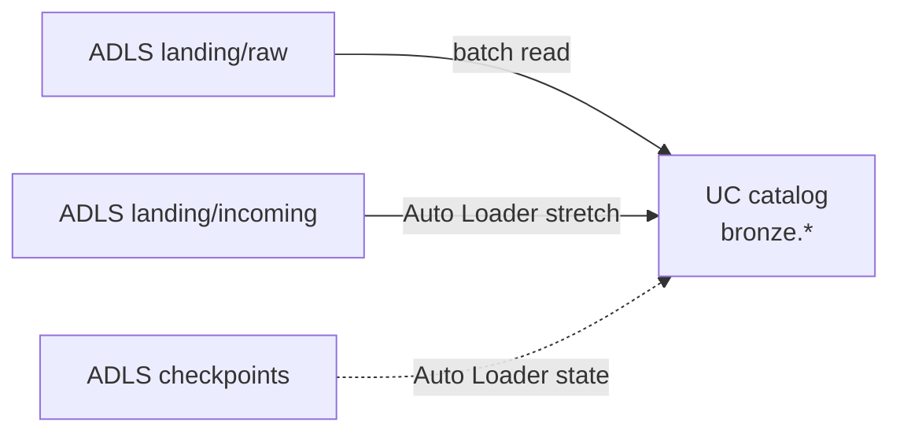

# Phase 1: Bronze ingestion

Phase 1 of the [Project B exercises](./README.md). Environment facts: [engineer runbook](../runbook.md).

## Where you are

- Catalog `sar_sandbox_<you>` exists and is empty of medallion schemas.
- Seed files sit under `landing` → `raw/` (see [overview — test data](./README.md#test-data--where-it-lives-and-how-you-use-it)).
- Starter notebook: [`01_bronze_ingest.py`](../../../../project-deployments/project-b/notebooks/01_bronze_ingest.py). Run [`00_setup_check.py`](../../../../project-deployments/project-b/notebooks/00_setup_check.py) first.

## Concepts first

**Medallion architecture** organises a lake into progressive layers. **Bronze** is the landing zone inside the lakehouse: you copy source data into Delta tables **without fixing business quality**. You preserve the raw shape (or a faithful typed read) and add **load metadata** so you can always answer “where did this row come from?”

**Append-only / immutability (at this layer):** Bronze should record what arrived. Cleaning belongs in Silver. If you “fix” nulls in Bronze, you destroy evidence.

**Schema-on-read:** Files may not have a rigid warehouse schema. You choose how to interpret columns when you read them. Bronze often keeps strings / variants and defers hard casts to Silver.

**Idempotency:** Running the same load twice must not create duplicate logical rows (or you must deliberately version batches). A naive `mode("append")` against a static file will **double** your row count — that is a teaching moment, not a bug in Databricks.

**Research further:** Databricks Auto Loader (`cloudFiles`), Delta Lake transaction log, and “schema evolution” vs “schema enforcement”.

## Diagram — what connects



## What you have been given

| Item | How to find it |
|------|----------------|
| Landing URL | `terraform output -raw landing_external_location` |
| Checkpoints URL | `terraform output -raw checkpoints_external_location` |
| Catalog name | `terraform output -raw catalog_name` |
| Cluster policy | Use policy id from outputs — **only** create clusters under it |

Files to ingest (at minimum):

- `raw/sar_requests/requests_2024.json`
- `raw/events/status_events.csv`
- `raw/logs/api_access.jsonl`
- `raw/reference/officers.csv`

Treat `raw/sar_requests/requests_2024_tail_truncated.json` carefully — do not let one corrupt file fail the entire bronze load (stretch).

## Guided build

### 1. Create the `bronze` schema and table contracts

Create schema `bronze` in your catalog.

Create **one Delta table per source**. Suggested names:

| Table | Source | Notes |
|-------|--------|-------|
| `bronze.sar_requests` | `requests_2024.json` | Keep columns as read; do not rename `requestor_id` / `requester_id` yet |
| `bronze.status_events` | `status_events.csv` | |
| `bronze.api_access_logs` | `api_access.jsonl` | |
| `bronze.officers` | `officers.csv` | Small reference file |

**Mandatory audit columns on every bronze table:**

| Column | Type | Meaning |
|--------|------|---------|
| `_source_file` | string | Path or file name of the source |
| `_ingested_at` | timestamp | When this load wrote the row |
| `_batch_id` | string | Your load identifier (e.g. run UUID or `yyyy-MM-dd'T'HH:mm`) |
| `_raw_payload` | string (optional but recommended) | Original JSON/CSV line or row as text for forensics |

Pattern sketch (you complete it):

```python
# Pseudocode — fill in paths, catalog, and write mode
df = spark.read.format("json").load(path)  # or csv / jsonl
df = (
    df.withColumn("_source_file", F.input_file_name())
      .withColumn("_ingested_at", F.current_timestamp())
      .withColumn("_batch_id", F.lit(batch_id))
)
# TODO: write to bronze.<table> as Delta
```

**Do not** drop nulls, fix enums, or cast `sla_days` in Bronze.

### 2. Prove the idempotency problem, then fix it

1. Load once; record `COUNT(*)` for `bronze.sar_requests`.
2. Run the **same** notebook again with the same write mode you first chose.
3. If the count doubled, document it.
4. Change the load so a second run does **not** double logical rows. Choose and **justify** one approach, for example:
   - overwrite for full refresh of a static snapshot table;
   - merge / delete+insert keyed by `_batch_id` + natural key;
   - Auto Loader checkpoints (stretch);
   - partition overwrite by batch.

Write 3–5 sentences for your mentor explaining **which** mechanism you chose and **why** it fits a static seed corpus.

### 3. Derived micro-batches

Using `created_at` from requests (parse best-effort; do not polish for Silver yet):

1. Identify distinct year-months present in the file.
2. Load **one month at a time** into Bronze (separate `_batch_id` per month), or stage month slices then write.
3. Explain how this differs from “new files arrived in the lake.”

This teaches incremental **windows** without waiting for new blobs.

## Stretch challenge

Plan and implement — no step-by-step method:

1. Switch request (or event) ingestion to **Auto Loader** with checkpoints under the **checkpoints** external location (not under `raw/`).
2. Use [`99_simulate_arrivals.py`](../../../../project-deployments/project-b/notebooks/99_simulate_arrivals.py) to write **new file paths** under `incoming/batch=<timestamp>/`. Prove Auto Loader picks them up. Re-running against unchanged `raw/` paths alone is **not** sufficient proof.
3. Ensure the truncated JSON file does not abort the whole pipeline — quarantine or skip with a logged reason.

**Acceptance:** Mentor can drop a new file via the simulator and see new Bronze rows without double-counting prior files; corrupt file is handled explicitly.

## You are done when

- [ ] Schema `bronze` exists with the four tables above (or mentor-agreed equivalents).
- [ ] Every table has the audit columns.
- [ ] Second full run does not double row counts (or overwrite behaviour is documented and intentional).
- [ ] Micro-batch month loads demonstrated once.
- [ ] Short write-up of idempotency choice submitted.
- [ ] Stretch attempted or deferred with mentor agreement.

## Questions your mentor will ask

1. Why keep bad data in Bronze instead of fixing it on ingest?
2. What does Auto Loader use to know a file was already processed?
3. If Terraform overwrites `raw/requests_2024.json` with new content at the **same path**, will Auto Loader re-read it? Why or why not?

---

[Exercise summary](./README.md) · Next: [Phase 2 — Silver](./phase-2-silver-quality.md)
