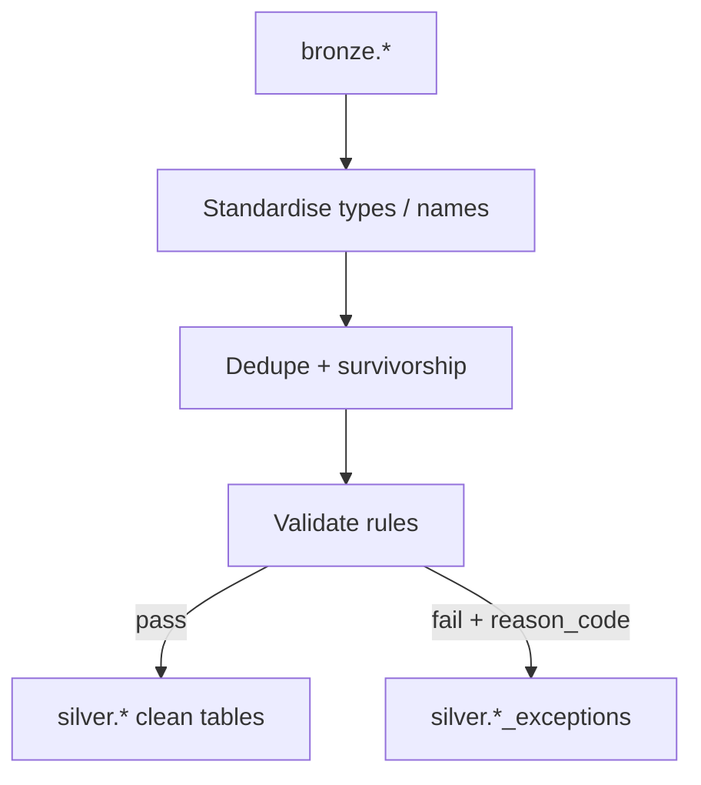

# Phase 2: Silver cleansing & quality

Phase 2 of the [Project B exercises](./README.md). Prerequisite: [Phase 1 — Bronze](./phase-1-bronze-ingestion.md).

## Where you are

Bronze tables exist with raw-ish data and audit columns. The seed data contains **deliberate** defects. Your job is to **discover** them, then build a Silver layer that is safe for modelling.

Starter notebook: [`02_silver_cleanse_quarantine.py`](../../../../project-deployments/project-b/notebooks/02_silver_cleanse_quarantine.py).

## Concepts first

**Data quality dimensions** (research each briefly): completeness, validity, consistency, uniqueness, timeliness, accuracy / referential integrity.

**Quarantine / dead-letter pattern:** Invalid rows do not disappear. They go to an **exceptions** table with a **reason code**, while valid rows proceed. Dropping rejects silently is a red flag.

**Survivorship rules:** When duplicates exist, define which row wins (e.g. latest `_ingested_at`, non-null preferred columns).

**Schema drift:** Source systems rename or add columns over time. Silver must resolve aliases (e.g. `requestor_id` vs `requester_id`) without hard-coding a single brittle name forever.

**Research further:** Great Expectations / dbt tests concepts; Delta constraints; “fail the pipeline” vs “quarantine and continue.”

## Diagram

## What you have been given

- All `bronze.*` tables from Phase 1.
- Reference officers in Bronze (or re-read `raw/reference/officers.csv`).
- Mentors will **not** hand you a defect list until you have profiled — discovery is part of the exercise.

## Guided build — layers

Work one layer at a time. Exit each layer before the next.

### Layer A — Profile and discover

1. Profile `bronze.sar_requests` (and events/logs as needed): null rates, distinct counts, sample bad values, min/max dates.
2. Produce a short **defect list** (your own words): what looks wrong, roughly how often.
3. Review with your mentor before building quarantine codes.

**Exit Layer A when:** You have a written defect list (even if incomplete).

### Layer B — Standardise

Create schema `silver`.

Build standardised request rows:

- Trim whitespace on identifiers.
- Resolve officer id column drift (`requestor_id` / `requester_id`) into one column, e.g. `officer_id`.
- Normalise casing on enums you choose to enforce (priority, status) — or quarantine unknown values (decide and document).
- Parse timestamps with **multiple** format attempts; unparseable → quarantine.
- Cast `sla_days` to integer; non-numeric → quarantine.

**Exit Layer B when:** A standardised DataFrame (or temp view) exists and you can show before/after samples.

### Layer C — Deduplicate

Define the natural key for requests (`request_id` after trim).

Implement survivorship and remove exact / near duplicates.

**Exit Layer C when:** Distinct trimmed `request_id` count is stable across re-runs; you can explain survivors.

### Layer D — Validate and quarantine

Create exceptions tables, for example:

| Table | Purpose |
|-------|---------|
| `silver.sar_requests_exceptions` | Failed request rows + metadata |
| `silver.status_events_exceptions` | Failed events (optional but recommended) |

Suggested columns for exceptions:

| Column | Meaning |
|--------|---------|
| `reason_code` | Stable code, e.g. `NULL_SUBJECT`, `TYPE_COERCION`, `TEMPORAL_INVALID`, `ORPHAN_OFFICER`, `ENUM_INVALID`, `PARSE_DATE` |
| `reason_detail` | Human-readable context |
| `_source_file`, `_ingested_at`, `_batch_id` | Lineage from Bronze |
| `payload` or key columns | Enough to reprocess later |

Valid rows land in:

| Table | Grain |
|-------|-------|
| `silver.sar_requests` | One row per valid request |
| `silver.status_events` | One row per valid event |
| `silver.api_access_logs` | One row per valid log line |
| `silver.officers` | One row per officer |

Validation ideas to implement (you may find more):

- Mandatory `subject_id` not null for requests.
- Referential integrity: officer exists in `silver.officers`.
- Temporal: `completed_at` not before `created_at` when both present.
- Event `changed_by` empty / null policy (document choice).

**Exit Layer D when:** Re-running Silver is idempotent; exceptions have reason codes; clean tables exclude quarantined rows.

### Layer E — Reconcile counts

Produce a small reconciliation summary (table or notebook cell):

- Bronze row counts vs Silver clean + exceptions.
- Explain any gaps (corrupt file, duplicates collapsed, etc.).

**Exit Layer E when:** Mentor can audit the arithmetic.

## Stretch challenge

1. Build `silver.data_quality_metrics` (or similar) with per-run counts by `reason_code` and source table.
2. Implement **drift-tolerant** officer-id resolution that does not hard-code only one of `requestor_id` / `requester_id` (e.g. coalesce across known aliases, or schema-driven mapping).

**Acceptance:** Metrics table updates each Silver run; alias resolution works if either column name is present.

## You are done when

- [ ] Schema `silver` with clean tables and at least one exceptions table.
- [ ] Defect discovery list reviewed with mentor.
- [ ] Reason codes applied; no silent drops of known bad rows.
- [ ] Reconciliation explained.
- [ ] Stretch attempted or deferred with mentor agreement.

## Questions your mentor will ask

1. What is the difference between a duplicate and a near-duplicate in your rules?
2. Why might you quarantine an orphan foreign key instead of dropping the fact?
3. Should Silver enforce enums by rejecting or by mapping? Trade-offs?

---

[Exercise summary](./README.md) · Previous: [Phase 1](./phase-1-bronze-ingestion.md) · Next: [Phase 3 — Gold](./phase-3-gold-dimensional-model.md)
