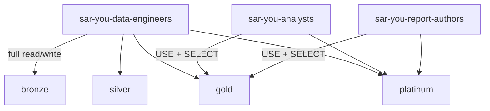

# Phase 5: Governance & access management

Phase 5 of the [Project B exercises](./README.md). Prerequisite: Gold and Platinum schemas exist ([Phase 3](./phase-3-gold-dimensional-model.md), [Phase 4](./phase-4-platinum-business-logic.md)).

## Where you are

Medallion layers are built. Account groups already exist:

- `sar-<you>-data-engineers`
- `sar-<you>-analysts`
- `sar-<you>-report-authors`

Catalog-level baseline grants are managed by **platform Terraform**. You will implement **least privilege on schemas and tables you own**.

Starter notebook: [`05_governance_grants.sql`](../../../../project-deployments/project-b/notebooks/05_governance_grants.sql).

## Concepts first

**Unity Catalog hierarchy:** Metastore → catalog → schema → table/view/function/volume. Privileges are checked along the path (`USE_CATALOG`, `USE_SCHEMA`, then object privileges).

**Least privilege:** Grant only what a persona needs. Analysts typically need Gold/Platinum, not Bronze/Silver raw/quarantine data.

**Ownership:** Creators often own schemas/tables they create and can `GRANT` on them. Catalog ownership may stay with platform admins — that is normal.

**Why this phase is schema-scoped:** Platform Terraform keeps an authoritative catalog grant set. Manual **catalog-level** grants you add can be **reverted** on the next platform apply. Grant on **your** schemas/tables instead. Ask your mentor not to re-apply Terraform mid-phase unless necessary.

**Research further:** Privilege inheritance; dynamic views; row filters / column masks; tagging (`APPLY_TAG`) for PII classification.

## Target access model



Analysts and report authors must **not** receive `SELECT` on `bronze` or `silver` (including exceptions tables).

## Guided build

### 1. Inventory

List schemas and key tables. Confirm you are the owner (or have grant rights) on `bronze`, `silver`, `gold`, `platinum`.

### 2. Apply schema-level grants

Example shape (replace group names and catalog):

```sql
-- Engineers already have broad catalog rights from platform — tighten schemas if needed.
GRANT USE_SCHEMA, SELECT ON SCHEMA gold TO `sar-<you>-analysts`;
GRANT USE_SCHEMA, SELECT ON SCHEMA platinum TO `sar-<you>-analysts`;
GRANT USE_SCHEMA, SELECT ON SCHEMA gold TO `sar-<you>-report-authors`;
GRANT USE_SCHEMA, SELECT ON SCHEMA platinum TO `sar-<you>-report-authors`;

-- Explicitly do NOT grant bronze/silver to analysts or report authors.
```

Grant table-level privileges if your mentor prefers finer control.

### 3. Prove with an access-test matrix

With mentor help (second user or temporary group membership), verify:

| Principal | bronze | silver | gold | platinum |
|-----------|--------|--------|------|----------|
| data-engineers | allow | allow | allow | allow |
| analysts | deny | deny | allow | allow |
| report-authors | deny | deny | allow | allow |

Record actual SQL errors for deny cases as evidence.

## Stretch challenge

1. Create dynamic views (or equivalent) that **mask** `subject_id` for analysts while engineers still see clear values.
2. Apply tags (e.g. PII) to sensitive columns using `APPLY_TAG` where available.
3. Extend the access-test matrix to include masked vs clear reads.

**Acceptance:** Evidence table shows deny/allow/mask behaviour; mentor reviews tags.

## You are done when

- [ ] Grant statements applied at schema/table level.
- [ ] Access-test matrix completed with evidence.
- [ ] Analysts cannot read bronze/silver.
- [ ] Stretch attempted or deferred with mentor agreement.

## Questions your mentor will ask

1. Why might catalog-level grants be owned by platform Terraform?
2. What is the difference between workspace assignment (`USER`) and Unity Catalog `SELECT`?
3. If an analyst has `USE_CATALOG` only, can they query Gold? What else is required?

---

[Exercise summary](./README.md) · Previous: [Phase 4](./phase-4-platinum-business-logic.md) · Next: [Phase 6 — Streaming](./phase-6-streaming-near-real-time.md)
