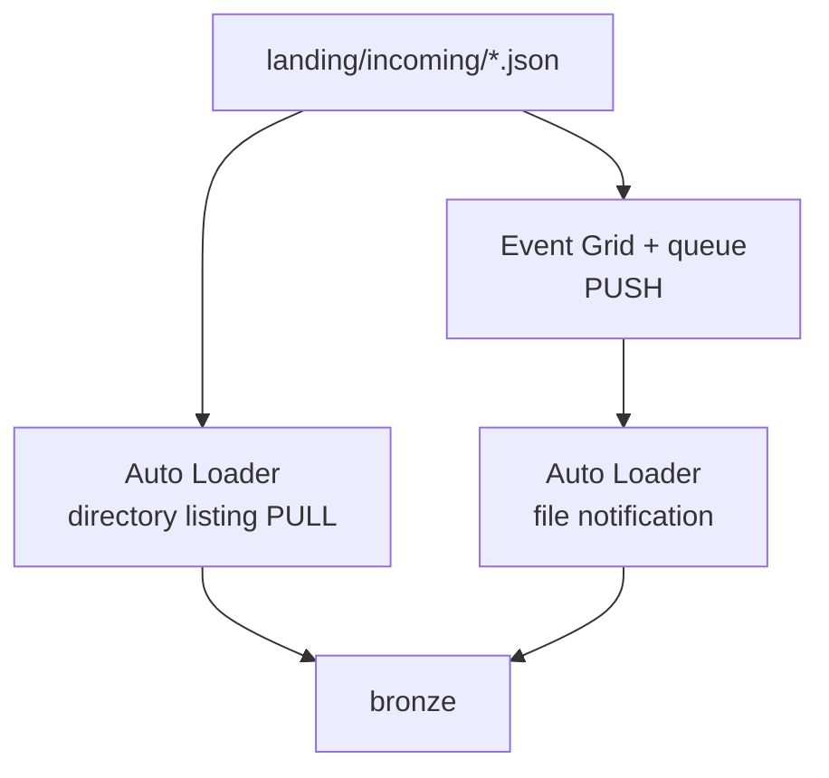

# Phase 6: Streaming & near-real-time (capstone)

Phase 6 of the [Project B exercises](./README.md). Prerequisites: Phases 1–5. This phase converts your batch medallion into a **continually updated** lake for near-real-time analytical use cases.

Starter notebooks: [`06_streaming_nrt.py`](../../../../project-deployments/project-b/notebooks/06_streaming_nrt.py), [`99_simulate_arrivals.py`](../../../../project-deployments/project-b/notebooks/99_simulate_arrivals.py).

## Where you are

You already understand Bronze → Platinum and governance. Now you revisit ingestion and refreshes under **latency**, **cost**, and **operational** constraints.

## Cost warning (read before any continuous stream)

The cluster policy auto-terminates idle clusters in 10–20 minutes, but a **continuously running stream never goes idle**, so auto-termination **does not protect you**.

A single-node cluster left streaming 24/7 can cost **hundreds of pounds per month** against a ~£100 engineer budget (alert at 80%).

**Default in this sandbox:** `Trigger.AvailableNow` (or equivalent micro-batch job triggers) + **scheduled Jobs**.

**Allowed once, supervised:** one short continuous streaming window with your mentor present; record DBU / cost impact before and after; **hard stop** when done.

Never leave a stream running overnight.

## Concepts first

| Concept | One-line meaning |
|---------|------------------|
| **Pull ingestion** | Consumer polls the source (e.g. Auto Loader directory listing) |
| **Push ingestion** | Source notifies consumer (e.g. Event Grid → queue → Auto Loader file notification) |
| **Micro-batch** | Spark Structured Streaming processes data in small batches |
| **Event time vs processing time** | When the event happened vs when you processed it |
| **Watermark** | Bound on how late data may arrive for stateful ops |
| **Delivery semantics** | At-most-once / at-least-once / exactly-once (and what your sink must do) |
| **Idempotent sink** | Replay-safe writes (`MERGE`, deterministic keys, checkpoints) |
| **Freshness SLA** | How stale dashboards may be and still be “good enough” |

**Research further:** Auto Loader file notification mode; Spark `foreachBatch`; checkpoint recovery; small-file problem and `OPTIMIZE`; backpressure.

## Diagram — pull vs push

## Guided build

### 1. Pull ingestion

Configure Auto Loader in **directory listing** mode with `Trigger.AvailableNow`, reading `incoming/`. Schedule as a Databricks Job (even if you trigger manually).

Measure: time from file drop → Bronze visibility as file count in `incoming/` grows (use the simulator to drop 1, then N files).

### 2. Push ingestion

Switch the same logical source to **file notification** mode using the platform-provisioned storage queue (see Terraform outputs for queue name / storage account).

Drop identical batches via `99_simulate_arrivals.py`. Fill a **comparison table**:

| Mode | Latency observed | Cost / complexity notes | When you would choose it |
|------|------------------|-------------------------|--------------------------|
| Pull (listing) | | | |
| Push (notification) | | | |

### 3. Streaming Silver

`readStream` from Bronze (Change Data Feed if appropriate). Apply Phase 2 quality rules inside `foreachBatch`. Route failures to quarantine tables **without failing the whole stream**.

### 4. Streaming Gold

Incremental `MERGE` into facts via `foreachBatch`; stream-static join to dimensions. Handle late status events with a watermark strategy you can explain.

### 5. Freshness measurement

Instrument end-to-end latency: file land → Bronze → Silver → Gold. State the freshness SLA your pipeline actually achieves (e.g. “within 5 minutes of job schedule”).

### 6. Cost discipline evidence

Show Jobs using AvailableNow (screenshots or run history). If you run a continuous window, show start/stop times and mentor sign-off.

### 7. Governance retrofit

Apply Phase 5 grants to any **new** streaming tables/views. Governance is continuous, not a one-off gate.

## Common challenges and design considerations

| Challenge | Why it bites | Mitigation direction |
|-----------|--------------|----------------------|
| Duplicate delivery on replay | At-least-once sources + non-idempotent sinks | `MERGE`, dedupe keys, checkpoints |
| Checkpoint corruption | Stream cannot safely resume | Repair/reset policy; avoid double-count |
| Schema drift mid-stream | New columns / renames break parsers | Evolution modes; quarantine; contracts |
| Small files | Many tiny arrivals → listing and read overhead | Batching, compaction/`OPTIMIZE`, larger micro-batches |
| Unbounded state | Watermark too loose / missing | Tighten watermark; keyed state TTL |
| Stream-static join staleness | Dimension updated after stream started | Refresh strategy; broadcast cadence |
| Quarantine backlog | Nobody monitors exceptions | Metrics, alerts, SLAs on quarantine age |
| BI keeps warehouse warm | DirectQuery defeats auto-stop | Import mode, aggregations, scheduled refresh |

## Capstone stretch

Design and implement a **near-real-time compliance SLA view** (requirements only — you plan the method):

1. Define a freshness target.
2. Choose and justify trigger strategy (AvailableNow vs short continuous).
3. Handle late events.
4. Prove exactly-once (or clearly document residual at-least-once risk and mitigations).
5. Apply Phase 5 governance to new objects.
6. Write a short design note: latency vs cost vs complexity; failure modes; what changes at ~1000× volume.

**Acceptance:** Working view or table + design note reviewed; cost controls demonstrated.

## You are done when

- [ ] Pull and push comparison table completed.
- [ ] Streaming (or AvailableNow job) path updates Silver/Gold with quarantine on failure.
- [ ] Freshness SLA stated with measurement method.
- [ ] Cost discipline evidenced; no abandoned continuous streams.
- [ ] New objects governed.
- [ ] Capstone stretch submitted or deferred with mentor agreement.

## Questions your mentor will ask

1. Why can directory listing look “fine” in a sandbox with few files but fail operationally at scale?
2. Does Auto Loader file notification give you exactly-once end-to-end by itself?
3. Why is “near real-time” an economic decision as much as a technical one?

---

[Exercise summary](./README.md) · Previous: [Phase 5](./phase-5-governance-rbac.md)
