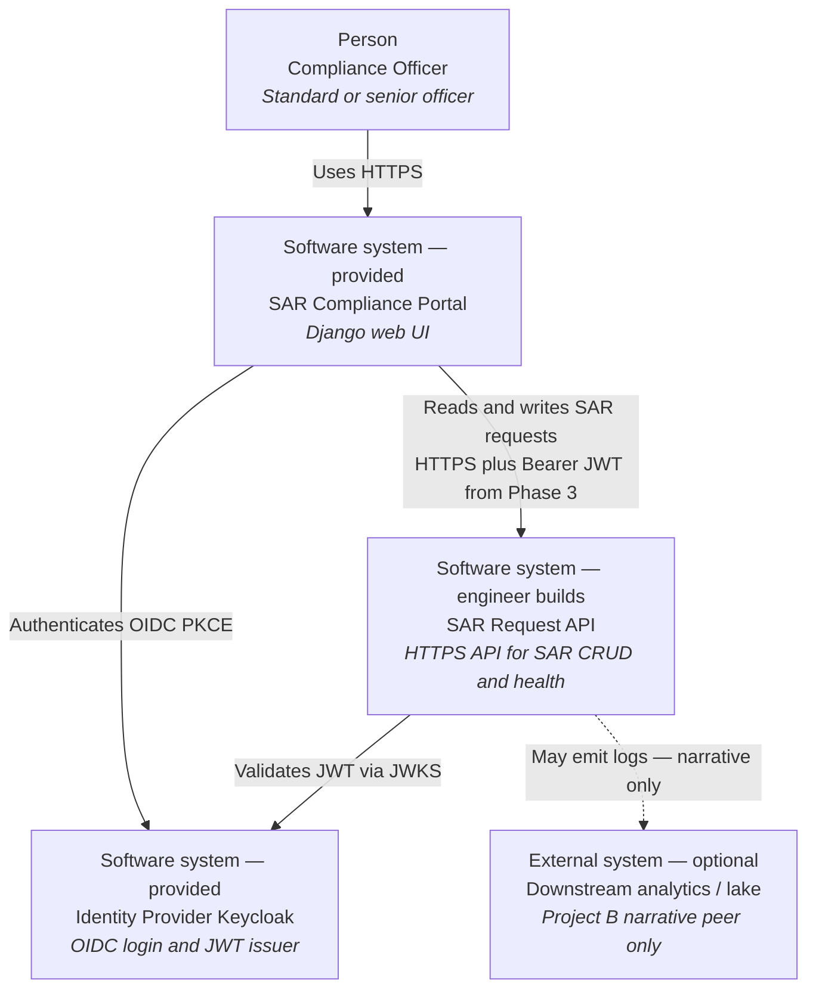

# Project A — Target C1 (System Context)

**Audience:** mentors / reference for juniors after they attempt their own diagram.  
**Scope:** end-state Project A (portal + IdP provided; SAR Request API built by the engineer).

C1 shows **people and software systems** only — not containers (API Gateway, Lambda, DynamoDB). Those belong on C2.

## Relationship notes

| From → To | Meaning |
|-----------|---------|
| Officer → Portal | Day-to-day UI; test users `officer.standard` / `officer.senior` |
| Portal → IdP | Login only; portal does not implement its own user store |
| Portal → API | Base URL from SSM `/sar-sandbox/<engineer>/api-base-url` |
| API → IdP | Phase 3 authorizer: issuer `…/auth/realms/sar-sandbox`, audience `sar-api` |
| API → Analytics | Optional programme story only; no runtime dependency in this sandbox |

## Boundary reminder

- **Provided:** Portal, Identity Provider (Keycloak).  
- **Engineer-built:** SAR Request API (and its AWS internals on C2).  
- **Out of C1:** DynamoDB, API Gateway, Lambda, CloudWatch — draw those on [C2](./c2-container.md).
