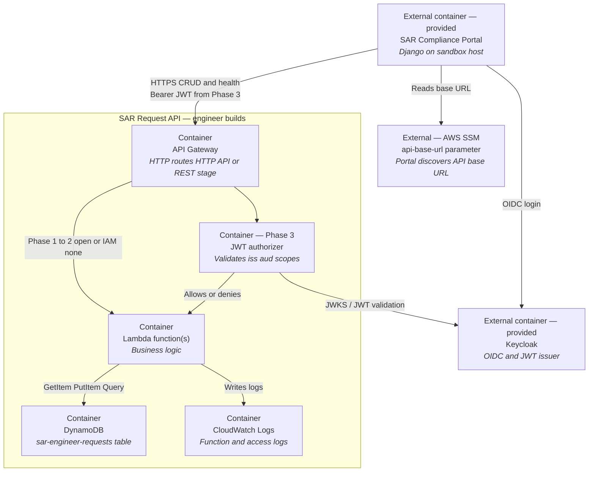

# Project A — Target C2 (Container)

**Audience:** mentors / reference for juniors.  
**Zoom:** inside the **SAR Request API** software system (engineer-built), with adjacent provided systems shown as externals.

C2 shows **containers** (deployable/runnable units) — not classes or Lambda-internal modules (those are C3).

## Relationship notes

| From → To | Meaning |
|-----------|---------|
| Portal → SSM | Discovers invoke base URL (`/sar-sandbox/<id>/api-base-url`) |
| Portal → API Gateway | All live traffic; include REST **stage** in base URL if using REST API |
| API Gateway → Authorizer → Lambda | Phase 3 path; before Phase 3, Gateway may invoke Lambda with auth `NONE` on routes |
| Lambda → DynamoDB | Persist SAR request envelopes (one table; `document_type` in item) |
| Lambda → CloudWatch | Operational logs; optional narrative feed to analytics on C1 |
| Authorizer → Keycloak | Trust issuer `…/auth/realms/sar-sandbox`, audience `sar-api` |

## Boundary reminder

- **In this diagram’s boundary:** API Gateway, authorizer, Lambda, DynamoDB, CloudWatch.  
- **Outside (provided):** Portal, Keycloak, SSM.  
- **Optional / not required:** dedicated S3 for payloads.  
- **Next level:** zoom into Lambda on [C3](./c3-component.md).
