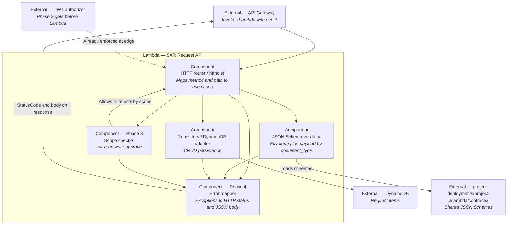

# Project A — Target C3 (Component)

**Audience:** mentors / reference for juniors (Phase 2+).  
**Zoom:** inside the **Lambda** container of the SAR Request API.

C3 shows **components** (major code modules / responsibilities) — not every file or function (that is C4).

## Component responsibilities

| Component | Phase | Responsibility |
|-----------|-------|----------------|
| HTTP router / handler | 1–2 | Dispatch `GET /health`, `/requests`, `/requests/{id}` |
| JSON Schema validator | 2 | Envelope + payload schema for `document_type` |
| Repository | 2 | DynamoDB read/write; one requests table |
| Scope checker | 3 | Enforce `sar:read` / `sar:write` / `sar:approve` (if not fully pushed into the Gateway authorizer) |
| Error mapper | 4 | Map domain/infra failures to stable HTTP codes and JSON errors |

## Boundary reminder

- Authorizer may sit **in API Gateway** (C2). If so, the Lambda scope checker is thin or only handles fine-grained rules — say so on your own diagram.  
- Do not redraw Portal/Keycloak internals here.  
- **Next level:** illustrative code modules on [C4](./c4-code.md).
