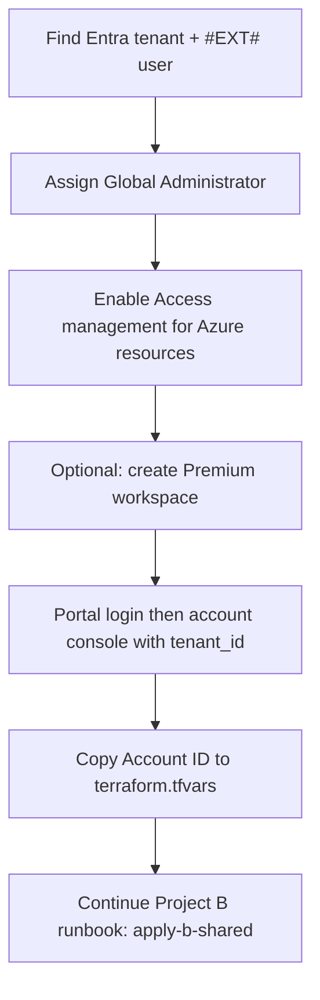

# Personal Azure account — Databricks & Unity Catalog setup

Use this guide when you signed up for Azure with a **personal Microsoft account** (`@outlook.com`, `@hotmail.com`, `@live.com`, or Gmail used as an MSA) and need **Databricks account admin** access before running `make apply-b-shared` in this repo.

**Organizational tenants** (work/school `@company.com` sign-in from day one) usually skip this guide — follow the [Project B (Azure) runbook](./project-b-azure-runbook.md) directly.

After you complete this guide, continue with the main runbook from [§2 Files to edit](./project-b-azure-runbook.md#2-files-to-edit) onward (`bootstrap-azure` → `apply-b-shared` → `apply-b`).

---

## Why personal accounts are different

| Identity | Azure Portal / billing | `az login` | Databricks account console |
|----------|------------------------|------------|----------------------------|
| Raw personal MSA (`you@outlook.com`) | Usually works | Often works | **Blocked** (`AADSTS500200`) |
| Entra guest UPN with `#EXT#` | Works after password reset | Works | **Usually required** for first login |
| Native `@<tenant>.onmicrosoft.com` member | Works | Works | May work **after** account is initialized |

Signing up for Azure with a personal address creates a **Microsoft Entra ID tenant** (for example `YourName.onmicrosoft.com`). Azure billing and the portal accept your MSA, but the Databricks **account console** (`https://accounts.azuredatabricks.net`) expects an **organizational Entra identity** in that tenant — typically the shadow **guest user** whose UPN contains `#EXT#`.

Unity Catalog and this repo’s shared Terraform stack (`terraform/project-b-azure-shared`) need:

1. **Databricks account admin** (established via the account console), and  
2. **`databricks_account_id`** in `terraform/project-b-azure-shared/terraform.tfvars` — a Databricks account UUID, **not** your Azure subscription ID.

---

## Overview



---

## 1. Find your tenant and identities

### 1.1 Tenant ID

Azure Portal → **Microsoft Entra ID** → **Overview** → copy **Tenant ID** (a GUID).

You will use it in:

```bash
az login --tenant "<tenant-id>"
```

and in the account console URL (step 4).

### 1.2 Users in Entra ID

Go to **Microsoft Entra ID** → **Users**. You typically see:

| User | Role in this guide |
|------|-------------------|
| `you_outlook.com#EXT#@<tenant>.onmicrosoft.com` | **Primary** identity for account console login |
| `you@outlook.com` (or your Gmail MSA) | Portal/billing; **do not** use for account console |
| `admin@<tenant>.onmicrosoft.com` (optional) | Convenience user for day-to-day `az login` **after** account admin exists |

If no `#EXT#` user appears, your signup may have created only an MSA-linked user. Create a native member user (step 2) and assign it **Global Administrator** — but still try the `#EXT#` path first if that user exists.

### 1.3 Optional: native admin user

Useful for everyday Azure CLI once Databricks is configured:

1. Entra ID → **Users** → **New user** → **Create new user**  
   Example UPN: `admin@<tenant>.onmicrosoft.com`
2. Set a strong password.
3. Assign **Global Administrator** (step 2 below).

This user alone often **cannot** open the account console on a personal subscription until a Global Admin completes the first account-console login (step 4).

---

## 2. Assign Global Administrator

The **first** Databricks account admin must be a **Microsoft Entra Global Administrator** at the time of their **first** login to the account console.

Entra ID → **Roles and administrators** → **Global Administrator** → **Add assignments**.

Assign **Global Administrator** to:

- the **`#EXT#` guest user** (recommended for first login), and optionally  
- your native `admin@...onmicrosoft.com` user.

Being Azure subscription **Owner** is not enough by itself.

---

## 3. Enable elevated Azure access (required once)

Entra ID → **Properties** → **Access management for Azure resources** → **Yes** → **Save**.

This lets a Global Administrator reach the Databricks account console to become the first account admin. Microsoft recommends setting this back to **No** after setup succeeds.

Wait **15–30 minutes** if the next step still fails immediately after changing this setting.

---

## 4. Open the Databricks account console

### 4.1 Optional but helpful: create a Premium workspace first

If the account console shows a generic connection error before any workspace exists, create one manually:

1. Signed into the portal as your **`#EXT#` user** (or Global Admin).
2. **Create a resource** → **Azure Databricks**.
3. **Pricing tier: Premium** (Unity Catalog requires Premium).
4. Region: match the runbook (default `uksouth`).
5. Wait until deployment **Succeeded**.

You can delete this bootstrap workspace later; Terraform may create its own per engineer.

**Important:** a Premium workspace (or Unity Catalog enablement) in a region often creates the **only** metastore allowed there. If `make apply-b-shared` later fails with *“reached the limit for metastores in region uksouth”*, adopt that metastore — see [Project B runbook §3.1](./project-b-azure-runbook.md#31-adopting-an-existing-metastore).

**Note:** **Manage account** in the workspace UI only appears **after** you are already a Databricks account admin. It is not the path to *get* access.

### 4.2 Login sequence (this is what usually works)

Use **one incognito browser window** and **one identity** throughout:

1. Sign in to [https://portal.azure.com](https://portal.azure.com) as the **`#EXT#` user**  
   Use the **full UPN** including `#EXT#`, not `you@outlook.com`.  
   Reset the password on that Entra user first if needed.
2. Confirm login works (you see your subscription).
3. Open a **new tab in the same window** (same session):

   ```text
   https://accounts.azuredatabricks.net/?tenant_id=<YOUR-TENANT-ID>
   ```

4. Click **Sign in with Microsoft Entra ID** if prompted.
5. Accept any **admin consent** prompt for Azure Databricks.

**Success:** the full account console loads (sidebar with Workspaces, Catalog, User management, Settings). On first login, you are automatically promoted to **Databricks account admin**.

**Partial success:** a **Select workspace** list without admin sidebar — auth worked but account admin was not established; retry with the `#EXT#` Global Admin, elevated access enabled, and the `tenant_id` URL.

**Failure:** generic *“unexpected error connecting to Databricks”* — ensure a Premium workspace exists (4.1), elevated access is Yes (§3), and you signed into the portal **before** opening the account console tab.

### 4.3 Enterprise applications (usually skip)

If the account console works, **admin consent already succeeded** during login. An empty **Enterprise applications** list is normal on a fresh personal tenant.

To verify optionally: Entra ID → **Enterprise applications** → set **Application type** to **All applications** → search `Azure Databricks` or app id `2ff814a6-3304-4ab8-85cb-cd0e6f879c1d`.

---

## 5. Copy the Databricks account ID

In the account console:

1. Click your **username** (top right).
2. Copy **Account ID** — a UUID like `0722779a-fd4e-49c1-a7a6-8417a97cf9ea`.

Paste it into `terraform/project-b-azure-shared/terraform.tfvars`:

```hcl
databricks_account_id = "0722779a-fd4e-49c1-a7a6-8417a97cf9ea"
```

**Do not** use your Azure **subscription ID** here.

---

## 6. Align Azure CLI with your admin identity

Terraform’s Databricks provider in this repo uses **`auth_type = "azure-cli"`**. Sign in as the same user you used for the account console (or another user you have promoted to account admin):

```bash
az logout
az login --tenant "<tenant-id>"
az account set --subscription "<subscription-id-or-name>"
az account show --query "{user:user.name, tenant:tenantId, subscription:id}" -o table
```

---

## 7. Continue the Project B runbook

From the [Project B (Azure) runbook](./project-b-azure-runbook.md):

1. **[§1.3 New Azure subscriptions](./project-b-azure-runbook.md#13-new-azure-subscriptions)** — register resource providers if you have not already.
2. **`make bootstrap-azure`** — does **not** need `databricks_account_id`.
3. Uncomment `azurerm` backends in shared and engineer roots.
4. **`make apply-b-shared`** — requires `databricks_account_id`.
5. **`make apply-b ENGINEER=...`** with metastore and access connector outputs.

---

## 8. Cleanup (recommended)

After `make apply-b-shared` succeeds:

1. Entra ID → **Properties** → set **Access management for Azure resources** back to **No**.
2. In the account console → **User management**, grant **Account admin** to your native `admin@...` user if you prefer that for day-to-day work.
3. Remove **Global Administrator** from identities that no longer need it (optional hardening).

---

## 9. Troubleshooting

| Symptom | Likely cause | Fix |
|---------|--------------|-----|
| `AADSTS500200` — personal account not supported | Signing in with raw `@outlook.com` / MSA | Use the `#EXT#` Entra UPN |
| `AADSTS50020` — user does not exist in tenant *Microsoft Services* | Wrong identity picked by browser | Incognito; **Use another account**; paste full `#EXT#` UPN |
| Generic “unexpected error connecting to Databricks” | No workspace yet, wrong tenant, or elevated access off | §3–§4.1; portal login **then** `?tenant_id=` URL |
| **Manage account** missing in workspace UI | You are not account admin yet | Normal until step 4 succeeds; use account console URL |
| **Select workspace** only (no admin sidebar) | Not first account admin | `#EXT#` user + Global Admin + elevated access + tenant URL |
| Empty **Enterprise applications** | Consent happened at login | Ignore if account console works |
| `databricks auth login` hangs or asks for account ID | Account-level CLI requires account ID **before** login | **Skip** until you have Account ID from console; Terraform uses `az login`, not Databricks CLI |
| Put subscription ID in `databricks_account_id` | Confused Azure subscription with Databricks account | Use UUID from account console username menu |

---

## 10. Checklist

```text
Tenant ID: ____________________________________
#EXT# UPN:  ____________________________________
  [ ] Global Administrator on #EXT# user
  [ ] Access management for Azure resources = Yes (then No after success)
  [ ] Optional Premium bootstrap workspace created
  [ ] Account console opens via portal → ?tenant_id= URL
  [ ] Account ID copied to terraform/project-b-azure-shared/terraform.tfvars
  [ ] az login --tenant ... + az account set
  [ ] Resource providers registered (main runbook §1.3)
  [ ] make bootstrap-azure
  [ ] make apply-b-shared
```

---

## Related docs

- [Project B (Azure) runbook](./project-b-azure-runbook.md) — full deploy sequence after account ID is set
- [Platform administrator runbook summary](./runbook.md)
- [Microsoft: Establish your first account admin](https://learn.microsoft.com/en-us/azure/databricks/admin/admin-concepts#establish-your-first-account-admin)
- [Microsoft: Locate your account ID](https://learn.microsoft.com/en-us/azure/databricks/admin/account-settings/#locate-your-account-id)
