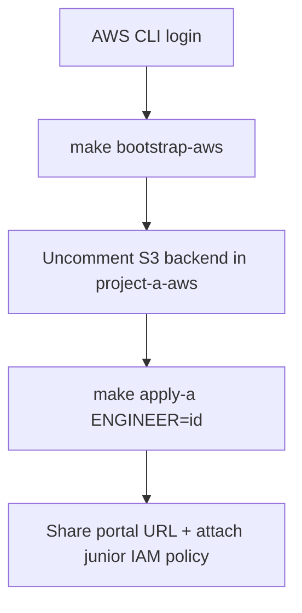

# Platform administrator runbook — Project A (AWS)

Provision the Django SAR portal, Keycloak, IAM baselines, and the SSM integration seam for one or more engineers. Junior engineers do **not** run these steps; they consume the outputs.

This runbook is self-contained: everything you need for the AWS track is here. If you are provisioning the Azure track as well, see the [Project B (Azure) runbook](./project-b-azure-runbook.md) — the two are independent and can be run in either order. Overview of both tracks: [platform administrator runbook summary](./runbook.md).

The junior builds Lambda, API Gateway, and DynamoDB themselves — those are intentionally **not** in this stack.

## 1. Prerequisites and tooling

### 1.1 Terraform (`>= 1.9`) and Make

**Linux (official zip):**

```bash
VER=$(curl -fsSL https://checkpoint-api.hashicorp.com/v1/check/terraform \
  | python3 -c "import sys,json; print(json.load(sys.stdin)['current_version'])")
curl -fsSL "https://releases.hashicorp.com/terraform/${VER}/terraform_${VER}_linux_amd64.zip" -o /tmp/terraform.zip
sudo unzip -o /tmp/terraform.zip -d /usr/local/bin
terraform version
```

**macOS:** `brew tap hashicorp/tap && brew install hashicorp/tap/terraform`

```bash
# make + Python (seed data / local scripts)
sudo pacman -S make python          # Arch / CachyOS
# sudo apt install make python3     # Debian/Ubuntu
```

Providers download automatically on `terraform init`.

### 1.2 AWS tooling

| Tool | Why |
|------|-----|
| AWS CLI v2 | Bootstrap + Project A apply |
| Session Manager plugin | `aws ssm start-session` onto the EC2 host (day-2 `.env` flips, logs) |
| `bash` + Python 3 | Staging the app artifact for S3 (no local Docker) |

Docker Engine is installed **on the EC2 sandbox host** by cloud-init and builds/runs the Compose stack there. You do **not** need Docker on your laptop to provision Project A.

**AWS CLI — Linux:**

```bash
curl -fsSL "https://awscli.amazonaws.com/awscli-exe-linux-x86_64.zip" -o /tmp/awscliv2.zip
unzip -o /tmp/awscliv2.zip -d /tmp
sudo /tmp/aws/install   # or user install to ~/.local
aws --version
```

**Session Manager plugin — Linux (x86_64, user install):**

```bash
TMP=$(mktemp -d) && cd "$TMP"
curl -fsSL "https://s3.amazonaws.com/session-manager-downloads/plugin/latest/linux_64bit/session-manager-plugin.rpm" \
  -o session-manager-plugin.rpm
bsdtar -xf session-manager-plugin.rpm   # or: rpm2cpio … | cpio -idmv
mkdir -p ~/.local/sessionmanagerplugin ~/.local/bin
cp -a usr/local/sessionmanagerplugin/. ~/.local/sessionmanagerplugin/
ln -sfn ~/.local/sessionmanagerplugin/bin/session-manager-plugin ~/.local/bin/session-manager-plugin
session-manager-plugin --version
# ensure ~/.local/bin is on PATH
```

**macOS:** `brew install awscli session-manager-plugin`

Without the plugin you can still use **SSM Run Command** or the AWS Console → EC2 → instance → Connect → Session Manager.

### 1.3 Credentials

```bash
# Access keys (typical personal/sandbox account)
aws configure --profile aws_sandbox
# Access Key ID / Secret / region eu-west-2 / output json

export AWS_PROFILE=aws_sandbox
export AWS_DEFAULT_REGION=eu-west-2
aws sts get-caller-identity
```

Or SSO: `aws configure sso` then `aws sso login --profile <name>`.

### 1.4 Optional lint / pre-commit

Not required to apply infrastructure.

```bash
# TFLint — brew install tflint  OR  install_linux.sh from terraform-linters/tflint
# Checkov / pre-commit — pipx or pip in a venv
pre-commit install   # if using .pre-commit-config.yaml
```

## 2. Files to edit

| File | Action |
|------|--------|
| [`terraform/bootstrap/aws/main.tf`](../../terraform/bootstrap/aws/main.tf) | Optional: `state_bucket_name` (must be **globally unique**), `aws_region` |
| [`terraform/project-a-aws/main.tf`](../../terraform/project-a-aws/main.tf) | After bootstrap: uncomment `backend "s3"` using bootstrap output snippet |
| [`terraform/project-a-aws/example.tfvars`](../../terraform/project-a-aws/example.tfvars) → `terraform.tfvars` | Recommended: `budget_alert_email`, `allowed_ingress_cidrs` |
| [`app/compose/.env.example`](../../app/compose/.env.example) → `.env` | Local Compose only (not required for cloud apply) |

Do **not** commit `terraform.tfvars` or `.env`.

Tell Terraform which profile to use via the environment (no code change needed):

```bash
export AWS_PROFILE=aws_sandbox
```

## 3. Deploy sequence



```bash
# From the repository root (where the Makefile lives):
export AWS_PROFILE=aws_sandbox   # or your profile name
make bootstrap-aws
# Record: records/bootstrap-aws.outputs.txt (+ .json, .apply.log)
# Paste backend_config_snippet into terraform/project-a-aws/main.tf, then:
terraform -chdir=terraform/project-a-aws init -migrate-state

make plan-a ENGINEER=alex
# Record: records/project-a-alex.plan.txt (+ .tfplan)

make apply-a ENGINEER=alex
# Record: records/project-a-alex.outputs.txt (+ .json, .apply.log)
```

Make writes a local audit trail under `records/` (gitignored). Re-print anytime with:

```bash
cat records/project-a-alex.outputs.txt
# or: cd terraform/project-a-aws && terraform workspace select alex && terraform output
```

### 3.1 What `apply-a` created

Per engineer (Terraform workspace = `ENGINEER`), you get an isolated VPC/subnet, an EC2 host with Elastic IP, S3 app artifact bucket, IAM baselines, SSM parameters for secrets/API URL, optional monthly budget, and a Docker Compose stack on the host (Caddy + Django + Keycloak + Postgres). The junior builds Lambda / API Gateway / DynamoDB themselves — those are intentionally **not** in this stack.

`apply-a` finishing is **not** the same as the portal being ready. First boot runs cloud-init: package updates, Docker install, image pulls, Django image build, then `docker compose up`. Expect **5–15 minutes** after apply before HTTPS answers. Progress lives on the instance at `/var/log/sar-bootstrap.log` (look for `Bootstrap complete`).

### 3.2 Outputs (handoff values)

| Output | What it is | What you do with it |
|--------|------------|---------------------|
| `portal_url` | Django SAR portal (`https://<eip>.nip.io`) | Share with the junior; smoke-test in a browser |
| `keycloak_url` | Keycloak under `/auth` | Admin console at `/auth/admin/`; realm endpoint `/auth/realms/sar-sandbox` |
| `hostname` | nip.io DNS name for the EIP | Same host used in OIDC redirect URIs |
| `instance_id` | EC2 instance id | Needed for SSM shells and [`redeploy.sh`](../../app/compose/redeploy.sh) |
| `lambda_execution_role_arn` | Pre-scoped role for their Lambdas | Tell them to attach this role to every function they create |
| `junior_developer_policy_arn` | Permissions for their IAM user/role | **You** attach this to their principal before they start Phase 1 |
| `api_base_url_parameter` | SSM name, e.g. `/sar-sandbox/alex/api-base-url` | They `put-parameter` their API Gateway base URL here after Phase 1 |
| `keycloak_admin_password_ssm` | SSM path for Keycloak `admin` password | Mentor-only recovery; do not share with juniors |
| `log_archive_bucket` | Optional CloudWatch export target | Nice-to-have; not required for Project B |

### 3.3 Verify before handoff

1. **Ingress / TLS** — `allowed_ingress_cidrs` must not be the documentation CIDR `203.0.113.0/24`. Sandboxes normally use `0.0.0.0/0` so Let’s Encrypt can complete HTTP-01 on ports 80/443. If the page times out or TLS fails, fix tfvars, re-apply the network module, then restart Caddy on the host (`docker restart compose-caddy-1`).
2. **Portal** — open `portal_url`; you should get the SAR portal home page (HTTP 200).
3. **Keycloak** — open `keycloak_url` (or `/auth/`). Bare `/auth` should redirect into Keycloak, not a Django 404. Realm check: `https://<hostname>/auth/realms/sar-sandbox` returns JSON.
4. **Portal login** — from the **portal** (`portal_url`), click login and sign in as a test officer (below). Do **not** use Keycloak’s admin console (`/auth/admin/`) for these users — they only exist in the `sar-sandbox` realm, and the admin console is the `master` realm (`admin` + SSM password). Success means OIDC client secret, redirect URI, and scopes all match this hostname.
5. **IAM** — attach `junior_developer_policy_arn` to the junior’s IAM user or role in the AWS console (or CLI). Without this they cannot create `sar-<id>-*` resources.

**Keycloak test users** (password for both: `Password123!`):

| Username | Role | Use when checking |
|----------|------|-------------------|
| `officer.standard` | `standard_officer` | Create/read/update requests (`sar:read`, `sar:write`) |
| `officer.senior` | `senior_officer` | Same plus approve (`sar:approve`) |

Keycloak admin console (`/auth/admin/`, realm **master** initially): username `admin`, password from SSM at `keycloak_admin_password_ssm`.

### 3.4 Post-provision

1. Attach `junior_developer_policy_arn` to the junior’s IAM principal.
2. Confirm Keycloak + portal login with `officer.standard` / `Password123!`.
3. If you set `budget_alert_email`, confirm the budget exists in Billing → Budgets (`sar-<id>-monthly`). Activate the `Engineer` cost allocation tag if you want tag-filtered spend to show (can take up to ~24h).
4. Note whether `enable_auto_stop` is on (default **true**): EventBridge will stop the instance on a schedule to save cost — start it again from EC2 when the junior needs it.
5. Handoff to the junior: `portal_url`, `lambda_execution_role_arn`, `api_base_url_parameter`, and point them at [Project A engineer runbook](../developer/project-a/runbook.md). Keep Keycloak admin credentials mentor-only.

## 4. Day-2 operations

Ongoing work after the first successful apply. Always use the **repo root** for Make targets, and keep `AWS_PROFILE` / region set.

### 4.1 Redeploy portal / Keycloak / Compose

Use when you change Django, Caddy, Keycloak realm, or Compose files and need them on an existing host (no full Terraform recreate):

```bash
# From repo root — needs instance_id from terraform output
./app/compose/redeploy.sh alex i-0abc123def456 eu-west-2
```

What it does: stages the portal stack plus schemas from `project-deployments/project-a/lambda/contracts` and the Lambda publish tree (no local Docker), uploads `s3://sar-<id>-artifacts-<account>/app/app.zip`, then SSM runs `docker compose up -d --build` on the host. Watch the script’s final SSM stdout for build errors.

Juniors publish Lambda zips **from the host** (`ENGINEER_ID=<id> ./publish.sh`). After changing host IAM or junior policy, `terraform apply` the Project A stack so `lambda:UpdateFunctionCode` is on the instance role. Existing hosts pick up `python3-pip` automatically the first time `publish.sh` runs (`sudo dnf install`).

If you only changed the Caddyfile on the host for a hotfix: `docker exec compose-caddy-1 caddy reload --config /etc/caddy/Caddyfile` (or restart `compose-caddy-1`).

### 4.2 Flip portal API modes (mentor)

These are **not** Terraform variables and **not** something the junior sets in AWS console for the portal.

| Place | Role |
|-------|------|
| SSM `/sar-sandbox/<id>/api-base-url` | Junior publishes their **API Gateway base URL** here |
| **`/opt/sar-sandbox/.env` on the EC2 sandbox host** | **You** set `SAR_API_MODE` / `SAR_API_AUTH_ENABLED` here |
| Laptop `app/compose/.env` | Only if you run Compose locally; ignored by the cloud host |

After first boot, cloud-init writes `/opt/sar-sandbox/.env` with `SAR_API_MODE=mock`. When the junior has put their health URL in SSM:

```bash
# From your laptop — open a shell on their host
aws ssm start-session --target <instance_id>   # from terraform output

# On the EC2 host (SSM user is ssm-user — use sudo for Docker):
sudo sed -i 's/^SAR_API_MODE=.*/SAR_API_MODE=live/' /opt/sar-sandbox/.env
# Phase 3 only, after their JWT authorizer works:
# sudo sed -i 's/^SAR_API_AUTH_ENABLED=.*/SAR_API_AUTH_ENABLED=true/' /opt/sar-sandbox/.env
sudo grep -E 'SAR_API_' /opt/sar-sandbox/.env

cd /opt/sar-sandbox/compose
sudo docker compose --env-file /opt/sar-sandbox/.env up -d django
```

| When | Set in host `.env` | Meaning |
|------|--------------------|---------|
| Before Phase 1 wiring | `SAR_API_MODE=mock` (default) | Portal uses built-in mock data |
| After Phase 1 health URL is in SSM | `SAR_API_MODE=live` | Portal calls their API via the SSM base URL |
| After Phase 3 JWT authorizer works | `SAR_API_AUTH_ENABLED=true` | Portal sends the officer’s access token as `Authorization: Bearer` |

Confirm on `portal_url`: badge should show `API: live` and the home-page health line should be their Lambda message, not “Hello from mock SAR API”.

`redeploy.sh` reuses the existing host `.env`; it does not reset these flags unless you overwrite that file.

### 4.3 Inspect a running sandbox

```bash
# Outputs / instance id
cd terraform/project-a-aws && terraform workspace select alex && terraform output

# Bootstrap + container health via SSM (replace instance id)
aws ssm start-session --target i-0abc123def456
# then on the host:
#   sudo tail -n 100 /var/log/sar-bootstrap.log
#   docker ps
#   docker logs compose-caddy-1 --tail 50
#   docker logs compose-keycloak-1 --tail 50
```

Keycloak admin password (mentor):

```bash
aws ssm get-parameter \
  --name "$(terraform -chdir=terraform/project-a-aws output -raw keycloak_admin_password_ssm)" \
  --with-decryption --query Parameter.Value --output text
```

### 4.4 Stop / start / destroy

| Task | Notes |
|------|--------|
| Instance auto-stopped | Expected when `enable_auto_stop=true`. Start the instance in EC2 (or CLI); containers should come back with `restart: unless-stopped`. If not, re-run compose from `/opt/sar-sandbox/compose`. |
| Tear down one engineer | `make destroy-a ENGINEER=alex` from repo root. Removes that workspace’s AWS resources. Does **not** delete the shared state bucket from bootstrap. |
| After destroy | Detach/delete their IAM policy attachment if you created a dedicated user; cancel unused budgets if left behind. |

## 5. Makefile defaults

| Variable | Default | Notes |
|----------|---------|-------|
| `ENGINEER` | `demo` | Terraform workspace name; set per engineer |
| `AWS_REGION` | `eu-west-2` | Project A only |
| `RECORDS` | `records` | Local plan/apply/output files (gitignored) |

## 6. Troubleshooting

| Symptom | Likely fix |
|---------|------------|
| `Unable to locate credentials` | `export AWS_PROFILE=...` and re-run `aws sts get-caller-identity` |
| S3 state bucket name taken | Change `state_bucket_name` in bootstrap AWS |
| Portal OIDC fails | Check nip.io hostname, Keycloak `/auth`, SSM `oidc-client-secret` |
| App artifact / stage fails | Ensure `scripts/stage-app-artifact.sh` is executable; Terraform stages via `data.external` during plan |
| Host containers not up | SSM into the instance and inspect `/var/log/sar-bootstrap.log`; first boot is often **5–15 min** (dnf + image pull + Django build) |
| Portal/Keycloak times out | Confirm `allowed_ingress_cidrs` is not still the example `203.0.113.0/24`; Let's Encrypt needs 80/443 reachable (usually `0.0.0.0/0` for sandboxes). After opening SG, restart Caddy so it retries ACME |
| HTTPS TLS errors after open SG | `docker restart compose-caddy-1` on the host; check `docker logs compose-caddy-1` for ACME success |

## 7. Checklist

Copy per engineer and tick as you go.

```text
Engineer ID: ____________________   AWS profile/region: ____________________

Pre-flight
  [ ] AWS_PROFILE works (sts get-caller-identity)
  [ ] terraform.tfvars: budget_alert_email (optional)
  [ ] terraform.tfvars: allowed_ingress_cidrs NOT 203.0.113.0/24
      (use 0.0.0.0/0 for sandbox TLS, or your IP only after certs exist)

Bootstrap + apply
  [ ] make bootstrap-aws (once per account) + backend snippet in project-a-aws
  [ ] make plan-a / apply-a ENGINEER=<id>
  [ ] records/project-a-<id>.outputs.txt saved

Host ready (5–15 min after apply)
  [ ] /var/log/sar-bootstrap.log shows "Bootstrap complete"
  [ ] portal_url loads (HTTPS 200)
  [ ] keycloak_url /auth redirects into Keycloak (not Django 404)
  [ ] /auth/realms/sar-sandbox returns JSON

Access smoke test
  [ ] Portal login as officer.standard / Password123!
  [ ] (optional) Keycloak admin console with SSM admin password

IAM + handoff
  [ ] junior_developer_policy_arn attached to their principal
  [ ] Shared with junior: portal_url, lambda_execution_role_arn,
      api_base_url_parameter, link to docs/developer/project-a/runbook.md
  [ ] Keycloak admin secret kept mentor-only

Optional
  [ ] Budget alert email received / budget visible in console
  [ ] Engineer cost allocation tag activated (if using tag filters)
  [ ] Noted auto-stop schedule; junior knows instance may be stopped overnight
```

## 8. Related docs

- [Platform administrator runbook summary](./runbook.md) — both tracks at a glance
- [Project B (Azure) runbook](./project-b-azure-runbook.md) — the other track
- [Architecture overview](../architecture.md)
- [Project A engineer runbook](../developer/project-a/runbook.md)
- [Mentor deploy notes](../mentor/deploy-notes.md)
