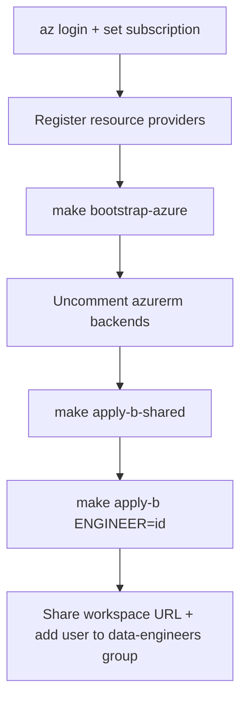

# Platform administrator runbook — Project B (Azure)

Provision ADLS Gen2 with seeded landing data, a Databricks workspace, Unity Catalog, and a SQL warehouse for one or more engineers. Junior engineers do **not** run these steps; they consume the outputs.

This runbook is self-contained: everything you need for the Azure track is here. If you are provisioning the AWS track as well, see the [Project A (AWS) runbook](./project-a-aws-runbook.md) — the two are independent and can be run in either order. Overview of both tracks: [platform administrator runbook summary](./runbook.md).

Sample SAR data is generated and seeded in-repo (`seed-data/`); it does **not** require a live Project A stack.

**First-time deploy?** Use the stage-based guide: **[Project B deployment stages](./project-b-deployment-stages.md)** — it matches personal MSA accounts, metastore adopt, and recovery from partial applies. This runbook is the full reference for day-2 work and troubleshooting.

## 1. Prerequisites and tooling

### 1.1 Terraform (`>= 1.9`) and Make

**Linux (official zip):**

```bash
VER=$(curl -fsSL https://checkpoint-api.hashicorp.com/v1/check/terraform \
  | python3 -c "import sys,json; print(json.load(sys.stdin)['current_version'])")
curl -fsSL "https://releases.hashicorp.com/terraform/${VER}/terraform_${VER}_linux_amd64.zip" -o /tmp/terraform.zip
sudo unzip -o /tmp/terraform.zip -d /usr/local/bin
terraform version
```

**macOS:** `brew tap hashicorp/tap && brew install hashicorp/tap/terraform`

```bash
# make + Python (seed data / local scripts)
sudo pacman -S make python          # Arch / CachyOS
# sudo apt install make python3     # Debian/Ubuntu
```

Providers download automatically on `terraform init`.

### 1.2 Azure tooling

| Tool | Why |
|------|-----|
| Azure CLI | Bootstrap + Project B apply; Databricks provider uses `azure-cli` auth |
| Databricks account admin | Create/adopt Unity Catalog metastore (shared stack) |
| Python `>= 3.11` | `make seed-data` if you regenerate sample files |
| Optional: Databricks CLI | Day-2 workspace checks only |

**Azure CLI — Linux:** see [Install Azure CLI](https://learn.microsoft.com/en-us/cli/azure/install-azure-cli) for your distro (e.g. `pacman -S azure-cli`, or `uv tool install azure-cli`).

**macOS:** `brew install azure-cli`

```bash
az login
az account list -o table
az account set --subscription "<subscription-id-or-name>"
az account show --query '{name:name,id:id,tenant:tenantId}' -o table
```

Your identity must be able to create resource groups, storage, and Databricks workspaces. For `make apply-b-shared`, you also need **Databricks account admin**. Find the account ID in the Azure Databricks account console — required in tfvars.

**Personal Microsoft account** (`@outlook.com`, `@hotmail.com`, Gmail-as-MSA signup)? The account console rejects raw MSAs. Follow the dedicated guide first: **[Personal Azure account — Databricks setup](./personal-azure-databricks-setup.md)**.

On **CachyOS / Arch**, install the CLI from the official repos (`sudo pacman -S azure-cli`) rather than a Python/`uv` tool install — the standalone package avoids PATH and interpreter upgrade issues.

**Optional Databricks CLI** (day-2 checks only; **not** used by Terraform):

```bash
yay -S databricks-cli-bin   # CachyOS / Arch
databricks -v
```

Terraform authenticates via **`az login`** only. Do **not** use `databricks auth login --host https://accounts.azuredatabricks.net` for deploy — it requires an account ID you may not have yet and can hang. For account-level CLI queries after deploy, use `DATABRICKS_AUTH_TYPE=azure-cli` — see [§3.1 Option D](#option-d--databricks-cli-with-azure-cli-auth-no-databricks-auth-login).

See [Install or update the Databricks CLI](https://learn.microsoft.com/en-us/azure/databricks/dev-tools/cli/install) for curl/Homebrew alternatives.

### 1.3 New Azure subscriptions

Fresh subscriptions (Pay-As-You-Go, Visual Studio credits, new tenant sandboxes) often ship with **resource providers unregistered**. Terraform then fails on the first resource that needs a namespace Azure has not activated yet — commonly during `make bootstrap-azure` on the remote-state storage account:

```text
MissingSubscriptionRegistration: The subscription is not registered to use namespace 'Microsoft.Storage'
```

`Microsoft.Resources` (resource groups) is usually registered already, so bootstrap may create `rg-sar-sandbox-tfstate` and then fail on `azurerm_storage_account`.

**Before `make bootstrap-azure`**, sign in, select the subscription you will use for this sandbox, and register the providers Project B needs:

```bash
az login
az account set --subscription "<subscription-id-or-name>"
az account show --query '{name:name,id:id,tenant:tenantId}' -o table

for ns in \
  Microsoft.Storage \
  Microsoft.Databricks \
  Microsoft.Authorization \
  Microsoft.Consumption \
  Microsoft.Resources
do
  echo "Registering $ns ..."
  az provider register --namespace "$ns"
done
```

Check that **Microsoft.Storage** (and the others) reach `Registered` — not `Registering`:

```bash
az provider show --namespace Microsoft.Storage --query registrationState -o tsv
```

Registration typically takes **1–5 minutes**; on a brand-new subscription it can take longer. Wait before retrying Terraform.

| Provider | Used for |
|----------|----------|
| `Microsoft.Storage` | Remote state account (bootstrap), ADLS Gen2 lake, metastore storage |
| `Microsoft.Databricks` | Workspace and access connector |
| `Microsoft.Authorization` | Role assignments (access connector → storage, landing external location) |
| `Microsoft.Consumption` | Optional per–resource-group budget alerts |
| `Microsoft.Resources` | Resource groups (usually already registered) |

**Permissions:** registering providers requires `Microsoft.Resources/subscriptions/providers/register/action` — typically **Owner** or **Contributor** on the subscription. If `az provider register` returns authorization errors, ask a subscription admin to run the loop above or grant you Contributor on the subscription.

**After a failed bootstrap:** once providers are registered, run `make bootstrap-azure` again. Terraform reuses an existing `rg-sar-sandbox-tfstate` if the first run created it. Confirm with:

```bash
az group show -n rg-sar-sandbox-tfstate -o table
az storage account list -g rg-sar-sandbox-tfstate -o table
```

If the resource group exists but no storage account appears, a retry is usually enough. If Terraform reports state conflicts, inspect `terraform/bootstrap/azure` and align with what Azure actually created before re-applying.

### 1.4 Optional lint / pre-commit

Not required to apply infrastructure.

```bash
# TFLint — brew install tflint  OR  install_linux.sh from terraform-linters/tflint
# Checkov / pre-commit — pipx or pip in a venv
pre-commit install   # if using .pre-commit-config.yaml
```

## 2. Files to edit

Copy each `example.tfvars` to `terraform.tfvars` in the same directory. Do **not** commit `terraform.tfvars`.

### Shared stack — `terraform/project-b-azure-shared/terraform.tfvars`

| Variable | Required | Notes |
|----------|----------|-------|
| `databricks_account_id` | Yes | Databricks account UUID from account console — **not** subscription ID |
| `location` | Yes | Default `uksouth` |
| `create_metastore` | Yes | `true` for greenfield org tenant; **`false`** if bootstrap workspace already created metastore (personal MSA) |
| `existing_metastore_id` | When adopting | Metastore UUID when `create_metastore = false` — [§3.1](#31-adopting-an-existing-metastore) |
| `budget_alert_email` | No | Optional consumption budget alerts |

### Engineer stack — `terraform/project-b-azure-engineer/terraform.tfvars`

| Variable | Required | Notes |
|----------|----------|-------|
| `engineer_id` | Yes | e.g. `alex` — must match `ENGINEER=` on Make command |
| `databricks_account_id` | Yes | **Same UUID as shared** — needed for account-level groups |
| `location` | Yes | Match shared (`uksouth`) |
| `metastore_id` | Yes | From shared output (also pass as `METASTORE_ID` env to Make) |
| `access_connector_id` | Yes | From shared output |
| `access_connector_principal_id` | Yes | From shared output |
| `budget_alert_email` | No | Optional per-engineer budget |

Makefile `-var` flags for `METASTORE_ID`, `ACCESS_CONNECTOR_ID`, and `ACCESS_CONNECTOR_PRINCIPAL_ID` **override** the same keys in engineer tfvars if both are set.

### Backend snippets (after bootstrap)

| File | Action |
|------|--------|
| [`terraform/bootstrap/azure/main.tf`](../../terraform/bootstrap/azure/main.tf) | Optional: `location`, `resource_group_name` |
| [`terraform/project-b-azure-shared/main.tf`](../../terraform/project-b-azure-shared/main.tf) | Uncomment `backend "azurerm"` |
| [`terraform/project-b-azure-engineer/main.tf`](../../terraform/project-b-azure-engineer/main.tf) | Uncomment backend; distinct state `key` from shared |

## 3. Deploy sequence

### 3.0 Choose your path

| Your signup | Before §3 commands |
|-------------|-------------------|
| **Personal MSA** (`@outlook.com`, etc.) | Complete [Personal Azure account — Databricks setup](./personal-azure-databricks-setup.md) and [deployment Stage 1](./project-b-deployment-stages.md#stage-1--account--entra-personal-msa-only). Expect **`create_metastore = false`** if you created a bootstrap Premium workspace. |
| **Organizational tenant** (`@company.com`) | `az login` + [§1.3 provider registration](#13-new-azure-subscriptions). Usually **`create_metastore = true`**. |



```bash
# From the repository root (where the Makefile lives):
# New subscription? Complete §1.3 (register providers) before this block.

make bootstrap-azure
# Record: records/bootstrap-azure.outputs.txt (+ .json, .apply.log)
# Paste snippets into project-b-azure-shared and project-b-azure-engineer backends

cp terraform/project-b-azure-shared/example.tfvars \
   terraform/project-b-azure-shared/terraform.tfvars
# Set databricks_account_id; personal MSA → create_metastore=false + existing_metastore_id

make apply-b-shared
# Record: records/project-b-shared.outputs.txt

make b-shared-env   # prints export METASTORE_ID=... lines

cp terraform/project-b-azure-engineer/example.tfvars \
   terraform/project-b-azure-engineer/terraform.tfvars
# Set engineer_id, databricks_account_id, and shared output values

make apply-b ENGINEER=alex \
  METASTORE_ID='...' \
  ACCESS_CONNECTOR_ID='...' \
  ACCESS_CONNECTOR_PRINCIPAL_ID='...'
# Record: records/project-b-alex.outputs.txt (+ .json, .apply.log)
```

### 3.1 Adopting an existing metastore

Azure Databricks allows **one metastore per region per account**. If `make apply-b-shared` fails with:

```text
This account ... has reached the limit for metastores in region uksouth
```

a metastore already exists (common after a manual Premium bootstrap workspace or an earlier partial apply). **Adopt it** instead of creating another.

**Find the metastore ID** — the UI often does not label it clearly. Try these in order:

#### Option A — Account console URL (easiest if Catalog opens)

1. [Account console](https://accounts.azuredatabricks.net) → **Catalog** → click the **uksouth** metastore name.
2. Look at the browser address bar. The UUID is in the path:

   ```text
   https://accounts.azuredatabricks.net/data/XXXXXXXX-XXXX-XXXX-XXXX-XXXXXXXXXXXX/configurations?...
   ```

   Copy the segment between `/data/` and `/configurations`.

3. Alternatively, on the metastore **Configuration** tab, the **Storage root** path may end with the same UUID after the final `/`.

#### Option B — From your bootstrap workspace (no account console digging)

1. **Launch workspace** from the Azure portal.
2. **Catalog** in the left sidebar → select any catalog **except** `hive_metastore` (e.g. `samples` or `main`).
3. Open **Details** (info panel) → **Metastore Id**.

#### Option C — SQL in the workspace

In **SQL** or a notebook with a running SQL warehouse / cluster:

```sql
SELECT metastore_id, metastore_name, cloud, region
FROM system.information_schema.metastores;
```

#### Option D — Databricks CLI with Azure CLI auth (no `databricks auth login`)

Uses the same `az login` session as Terraform — you already have the account ID:

```bash
export DATABRICKS_HOST=https://accounts.azuredatabricks.net
export DATABRICKS_ACCOUNT_ID="<your-databricks-account-id>"
export DATABRICKS_AUTH_TYPE=azure-cli

databricks account metastores list -o json
```

Pick the object where `"region": "uksouth"` (or `"cloud": "azure"` and matching region) and copy `"metastore_id"`.

Then in `terraform/project-b-azure-shared/terraform.tfvars`:

```hcl
create_metastore      = false
existing_metastore_id = "<metastore-uuid>"
```

Re-run `make apply-b-shared`. The shared stack still creates the access connector; it skips metastore creation and passes through the existing ID as output.

### 3.2 If the workspace host will not resolve

If the first engineer apply fails resolving the Databricks workspace host:

```bash
cd terraform/project-b-azure-engineer
terraform workspace select alex
terraform apply -target=module.workspace \
  -var="engineer_id=alex" \
  -var="metastore_id=$METASTORE_ID" \
  -var="access_connector_id=$ACCESS_CONNECTOR_ID" \
  -var="access_connector_principal_id=$ACCESS_CONNECTOR_PRINCIPAL_ID"
terraform apply \
  -var="engineer_id=alex" \
  -var="metastore_id=$METASTORE_ID" \
  -var="access_connector_id=$ACCESS_CONNECTOR_ID" \
  -var="access_connector_principal_id=$ACCESS_CONNECTOR_PRINCIPAL_ID"
```

### 3.3 Outputs (handoff values)

Share: `databricks_workspace_url`, `catalog_name`, `landing_external_location`, `sql_warehouse_jdbc_url`, group names.

### 3.4 Post-provision

1. Add the junior’s Entra ID user to **`sar-<id>-data-engineers`** — account console → **User management** → open the group → **Add user**. See [Appendix: Portal navigation](#appendix-portal-navigation).
2. Power BI licences/workspaces are **manual** — [power-bi.md](../developer/project-b/power-bi.md).
3. Confirm budget alerts if configured.
4. Point the junior at the [Project B engineer runbook](../developer/project-b/runbook.md) and the [business questions](../developer/project-b/business-questions.md).

### 3.5 Recover from a failed engineer apply

Use when `make apply-b` failed **after** creating storage, workspace, or catalog but **before** groups, grants, or SQL warehouse succeeded. Full walkthrough: [deployment Stage 5R](./project-b-deployment-stages.md#stage-5r--recover-from-failed-engineer-apply).

**Do not delete** the `sar-<id>` workspace or resource group unless you intend a full reprovision ([§5.2](#52-tear-down-one-engineer-stack)).

1. **Ensure latest code** — engineer module requires account-level groups and `databricks_account_id` in engineer tfvars.
2. **Engineer tfvars** — [`terraform/project-b-azure-engineer/terraform.tfvars`](../../terraform/project-b-azure-engineer/terraform.tfvars) must include `databricks_account_id` (same as shared).
3. **Delete workspace-local groups only** (if present): in the **`sar-<id>` workspace** → **Administration** → **Groups** → remove `sar-<id>-data-engineers`, `-analysts`, `-report-authors`. Do not delete account-level groups unless re-apply reports duplicates.
4. **Optional:** delete stuck SQL warehouse `sar-<id>-sql` in workspace → **SQL**.
5. **Re-run:**
   ```bash
   make b-shared-env
   make apply-b ENGINEER=alex \
     METASTORE_ID="$METASTORE_ID" \
     ACCESS_CONNECTOR_ID="$ACCESS_CONNECTOR_ID" \
     ACCESS_CONNECTOR_PRINCIPAL_ID="$ACCESS_CONNECTOR_PRINCIPAL_ID"
   ```
6. If grants fail with *Could not find principal*, wait 60 seconds and retry once.

**When to destroy instead:** use `make destroy-b` only when you want a completely clean engineer sandbox, then re-run §3 deploy block for that engineer.

## 4. Day-2 operations

Ongoing maintenance after the first successful apply: refreshing landing data, managing the shared metastore, and verifying stacks. Always run Make targets from the **repo root**, with `az login` and the correct subscription selected.

For **provisioning or tearing down** an engineer sandbox, see [§5 Engineer sandbox lifecycle](#5-engineer-sandbox-lifecycle) instead.

### 4.1 Regenerate seed data and refresh landing storage

**When:** you change the generator script, want a fresh deterministic dataset, or need updated committed files in `seed-data/out/` before the next cohort.

**What `make seed-data` does:**

```bash
make seed-data
```

Runs `seed-data/generator/generate.py` with `--seed 42` and writes into `seed-data/out/`. That directory is **committed in git** so applies are stable; regenerating may change many files under `seed-data/out/`.

**Before you regenerate:**

1. Read [anomaly map](../mentor/anomaly-map.md) if you are changing teaching defects — juniors should not see it until after discovery.
2. Decide whether you need a **new seed** (`--seed` other than `42`) or the default reproducible set.

**After regeneration:**

1. Review the diff (`git diff seed-data/out/`) — expect CSV/JSON/JSONL and `manifest.json` updates.
2. Commit the updated `seed-data/out/` if this is the canonical dataset for the programme.
3. **Regenerating alone does not update ADLS.** Landing files are uploaded by Terraform in `terraform/project-b-azure-engineer` (`azurerm_storage_blob.seed` with `for_each = fileset(...)`). Blobs are replaced when `content_md5` changes.

**Refresh landing for one engineer** — set shared outputs first ([§5](#5-engineer-sandbox-lifecycle)), then:

```bash
# Optional: inspect changes first
make plan-b ENGINEER=alex \
  METASTORE_ID="$METASTORE_ID" \
  ACCESS_CONNECTOR_ID="$ACCESS_CONNECTOR_ID" \
  ACCESS_CONNECTOR_PRINCIPAL_ID="$ACCESS_CONNECTOR_PRINCIPAL_ID"

make apply-b ENGINEER=alex \
  METASTORE_ID="$METASTORE_ID" \
  ACCESS_CONNECTOR_ID="$ACCESS_CONNECTOR_ID" \
  ACCESS_CONNECTOR_PRINCIPAL_ID="$ACCESS_CONNECTOR_PRINCIPAL_ID"
```

Repeat per engineer workspace if several sandboxes share the same seed refresh.

**What this apply does *not* do:** it does not recreate the Databricks workspace, catalog, SQL warehouse, or metastore assignment unless other Terraform inputs changed. It mainly updates objects under `landing/raw/...` in that engineer’s storage account.

**Tell the junior:** if they already ingested old landing files into Bronze Delta tables, refreshed blobs under `raw/` do not automatically replace those tables — they may need to re-run ingestion, truncate Bronze, or start from a clean notebook path. Landing path is still `landing_external_location` from their stack output (`raw/...` prefix).

### 4.2 Shared metastore and shared stack lifecycle

**Rule:** do **not** destroy or recreate the shared stack while any engineer workspace is still assigned to the metastore.

Azure allows **one Unity Catalog metastore per region per account**. The shared apply either creates it or adopts an existing one (`create_metastore` / `existing_metastore_id`). Engineer stacks **assign** their workspace to that metastore; destroying an engineer stack removes one assignment, not the metastore — see [§5.2](#52-tear-down-one-engineer-stack).

**Safe order when winding down the whole programme:**

1. [Tear down each engineer stack](#52-tear-down-one-engineer-stack) until all workspaces are gone.
2. In the account console, confirm no workspaces remain assigned to the metastore (optional but clearer).
3. Only then consider destroying shared resources — there is **no** `make destroy-b-shared` target in the Makefile; you would run `terraform destroy` manually in `terraform/project-b-azure-shared` if you truly need to remove the access connector and shared RG. **Avoid** destroying an in-use metastore that other Azure Databricks workspaces (e.g. a bootstrap workspace) still reference.

**If you already adopted a bootstrap metastore:** keep `create_metastore = false` and the same `existing_metastore_id` in tfvars for all future shared applies. Do not flip back to `create_metastore = true`.

### 4.3 Inspect and verify

```bash
# Engineer outputs
cd terraform/project-b-azure-engineer && terraform workspace select alex && terraform output

# Shared outputs
cd terraform/project-b-azure-shared && terraform output

# Azure: confirm RG and workspace exist
az group show -n sar-alex -o table
az databricks workspace list -g sar-alex -o table
```

**Smoke test after apply or handoff:**

1. Open `databricks_workspace_url` → workspace loads.
2. **Catalog** → catalog `sar_sandbox_<id>` exists; landing external location resolves.
3. **SQL** → warehouse from output is running (may auto-stop after idle — expected).
4. Browse landing data: files under `raw/` reflect committed seed data.

**Cost:** if `budget_alert_email` is set in shared or engineer tfvars, confirm alerts in Azure Cost Management; SQL warehouse and clusters still incur spend while running — the engineer runbook documents auto-stop on the warehouse and a cost-capped cluster policy.

## 5. Engineer sandbox lifecycle

Provisioning a **new** engineer or **removing** one after the shared stack exists. First-time deploy of engineer `alex` is covered in [§3 Deploy sequence](#3-deploy-sequence); this section is for adding cohort members or teardown.

Keep shared outputs — from `records/project-b-shared.outputs.txt` or:

```bash
cd terraform/project-b-azure-shared && terraform output
```

Set these for every `plan-b`, `apply-b`, and `destroy-b` (replace with your values):

```bash
export METASTORE_ID='...'
export ACCESS_CONNECTOR_ID='...'
export ACCESS_CONNECTOR_PRINCIPAL_ID='...'
```

### 5.1 Provision an additional engineer

**When:** a new junior joins the programme; the shared stack and metastore are already in place.

```bash
make apply-b ENGINEER=sam \
  METASTORE_ID="$METASTORE_ID" \
  ACCESS_CONNECTOR_ID="$ACCESS_CONNECTOR_ID" \
  ACCESS_CONNECTOR_PRINCIPAL_ID="$ACCESS_CONNECTOR_PRINCIPAL_ID"
```

Optional: run `make plan-b ENGINEER=sam ...` first to review the plan. Outputs are recorded in `records/project-b-sam.outputs.txt`.

**Handoff (same as [§3.4 Post-provision](#34-post-provision)):**

1. Share outputs: `databricks_workspace_url`, `catalog_name`, `landing_external_location`, `sql_warehouse_jdbc_url`, group names.
2. Add the junior’s Entra ID user to **`sar-sam-data-engineers`** in the Databricks account console (User management) or workspace admin UI if they cannot sign in yet.
3. Point them at the [Project B engineer runbook](../developer/project-b/runbook.md) and [business questions](../developer/project-b/business-questions.md).

Each engineer gets an isolated storage account, workspace, catalog, and groups; they share the regional metastore and access connector.

### 5.2 Tear down one engineer stack

**When:** an engineer finishes the programme, you need to reclaim cost, or you are reprovisioning a clean sandbox for the same `ENGINEER` id.

```bash
make destroy-b ENGINEER=alex \
  METASTORE_ID="$METASTORE_ID" \
  ACCESS_CONNECTOR_ID="$ACCESS_CONNECTOR_ID" \
  ACCESS_CONNECTOR_PRINCIPAL_ID="$ACCESS_CONNECTOR_PRINCIPAL_ID"
```

Log is written to `records/project-b-alex.destroy.log`.

**What destroy removes (per engineer):**

| Removed | Notes |
|---------|--------|
| Resource group `sar-<id>` | Engineer-scoped RG from the engineer module |
| ADLS Gen2 account + containers | `landing`, `external`, `checkpoints` and all blobs (including seed uploads) |
| Azure Databricks workspace | Premium workspace for that engineer |
| Unity Catalog objects in that workspace | Catalog `sar_sandbox_<id>`, external locations, SQL warehouse, cluster policy, persona groups |
| Metastore **assignment** for that workspace | Workspace unlinked from shared metastore; **metastore itself stays** |
| Optional consumption budget | If `budget_alert_email` was set in tfvars |

**What destroy does *not* remove:**

| Kept | Notes |
|------|--------|
| Shared stack (`apply-b-shared`) | Access connector, shared RG `sar-shared`, adopted/created metastore |
| Bootstrap / temp workspace | Any workspace you created manually before Terraform (delete separately in Azure portal if unused) |
| Remote state storage | Bootstrap account `rg-sar-sandbox-tfstate` |
| Terraform workspace name | `terraform workspace select alex` still exists locally/remotely — harmless; reuse on next `apply-b` |

**After destroy:**

1. Confirm in Azure portal that `sar-<id>` resource group is gone.
2. In the [account console](https://accounts.azuredatabricks.net), confirm the engineer’s workspace no longer appears (or is cancelled).
3. If you added the junior’s Entra user to groups **manually** outside Terraform, remove those assignments.
4. Optionally delete the Terraform workspace: `cd terraform/project-b-azure-engineer && terraform workspace select default && terraform workspace delete alex` (only after destroy succeeds).

## 6. Makefile defaults

| Target / variable | Default | Notes |
|-------------------|---------|-------|
| `make b-shared-env` | — | Prints `export METASTORE_ID=...` from shared Terraform output |
| `ENGINEER` | `demo` | Terraform workspace name; set per engineer |
| `AZURE_LOCATION` | `uksouth` | Project B only |
| `RECORDS` | `records` | Local plan/apply/output files (gitignored) |

## 7. Troubleshooting

| Symptom | Likely fix |
|---------|------------|
| `MissingSubscriptionRegistration` / `Microsoft.Storage` on bootstrap | Register providers — [§1.3 New Azure subscriptions](#13-new-azure-subscriptions); wait for `Registered`, then retry `make bootstrap-azure` |
| `AuthorizationFailed` on `az provider register` | Need Contributor (or equivalent) on the subscription; ask a subscription admin |
| Bootstrap created RG but no storage account | Providers were still registering; retry `make bootstrap-azure` after `Microsoft.Storage` is `Registered` |
| Metastore limit / already exists in region | [§3.1 Adopting an existing metastore](#31-adopting-an-existing-metastore) — `create_metastore=false` + `existing_metastore_id` from account console → Catalog |
| Workspace provider host unknown | Two-phase apply with `-target=module.workspace` |
| `az` permission errors on `~/.azure` | Ensure that directory is owned by your user |
| `az login` fails or wrong subscription | `az account list` / `az account set`; prefer `/usr/bin/az` from pacman if a broken `~/.local/bin/az` shadows it |
| `AADSTS500200` / personal account / account console errors | [Personal Azure account — Databricks setup](./personal-azure-databricks-setup.md) |
| `databricks_account_id` unknown or wrong | Account console username menu — **not** subscription ID; see [personal account guide](./personal-azure-databricks-setup.md) |
| `Could not find principal` on `databricks_grants` | Unity Catalog needs **account-level** groups — pull latest module fix; delete any workspace-local groups with the same names in the workspace admin UI, then re-run `apply-b` |
| SQL warehouse create timeout / *Cluster Start-up Delayed* | Pull latest module (`min_num_clusters = 0`); re-run `apply-b` — warehouse starts on first use |

## 8. Checklist

Use the stage checklist in **[Project B deployment stages](./project-b-deployment-stages.md#stage-checklist-copy-per-deploy)** — it covers personal MSA, metastore adopt, engineer tfvars, and recovery.

Quick reference:

```text
Stage 0  Tooling:                          [ ]
Stage 1  Personal account (if MSA):       [ ]  skipped — org tenant
Stage 2  Providers registered:            [ ]
Stage 3  bootstrap-azure + backends:      [ ]
Stage 4  apply-b-shared:                   [ ]
         create_metastore=false (MSA):     [ ]
Stage 5  engineer terraform.tfvars:        [ ]
         apply-b ENGINEER=___:             [ ]
Stage 5R Recovery (if needed):            [ ]
Stage 6  Junior in data-engineers group:   [ ]
         Smoke test passed:                [ ]
Power BI licence (Phase 4):               [ ]  (optional / later)
```

## Appendix: Portal navigation

Where to click for common admin tasks (Azure and Databricks UI labels change occasionally — look for the closest match).

| Task | Where |
|------|--------|
| **Tenant ID** | Azure Portal → **Microsoft Entra ID** → **Overview** → Tenant ID |
| **#EXT# user / Global Admin** | Entra ID → **Users** / **Roles and administrators** |
| **Account console** | [accounts.azuredatabricks.net/?tenant_id=...](https://accounts.azuredatabricks.net) after portal login as `#EXT#` user (personal MSA) |
| **Databricks account ID** | Account console → username menu (top right) → **Account ID** |
| **Metastore ID** | Account console → **Catalog** → click metastore → UUID in URL between `/data/` and `/configurations` |
| **Add junior to data-engineers group** | Account console → **User management** → **`sar-<id>-data-engineers`** → Add user |
| **Workspace-local groups** (delete on recovery) | Workspace UI → **Administration** → **Groups** |
| **SQL warehouse** | Workspace UI → **SQL** → **SQL warehouses** |
| **Launch engineer workspace** | Azure Portal → resource group `sar-<id>` → Databricks workspace → **Launch workspace** |
| **Unity Catalog catalog** | Workspace UI → **Catalog** → `sar_sandbox_<id>` |
| **Enterprise applications** (optional) | Entra ID → **Enterprise applications** — often empty on fresh tenants; ignore if account console works |

## 9. Related docs

- **[Project B deployment stages](./project-b-deployment-stages.md)** — first-time deploy navigation

- [Personal Azure account — Databricks setup](./personal-azure-databricks-setup.md) — MSA / Outlook signup and account console access
- [Platform administrator runbook summary](./runbook.md) — both tracks at a glance
- [Project A (AWS) runbook](./project-a-aws-runbook.md) — the other track
- [Architecture overview](../architecture.md)
- [Project B engineer runbook](../developer/project-b/runbook.md)
- [Seed data anomaly map](../mentor/anomaly-map.md) (mentor only)
- [Mentor deploy notes](../mentor/deploy-notes.md)
