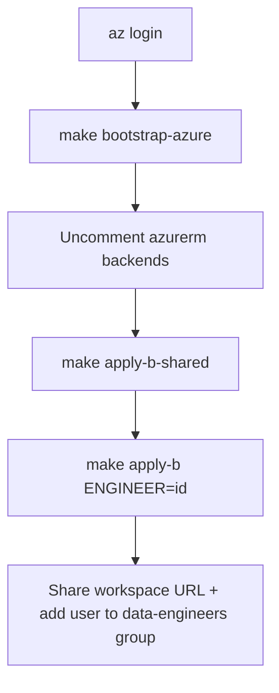

# Platform administrator runbook — Project B (Azure)

Provision ADLS Gen2 with seeded landing data, a Databricks workspace, Unity Catalog, and a SQL warehouse for one or more engineers. Junior engineers do **not** run these steps; they consume the outputs.

This runbook is self-contained: everything you need for the Azure track is here. If you are provisioning the AWS track as well, see the [Project A (AWS) runbook](./project-a-aws-runbook.md) — the two are independent and can be run in either order. Overview of both tracks: [platform administrator runbook summary](./runbook.md).

Sample SAR data is generated and seeded in-repo (`seed-data/`); it does **not** require a live Project A stack.

## 1. Prerequisites and tooling

### 1.1 Terraform (`>= 1.9`) and Make

**Linux (official zip):**

```bash
VER=$(curl -fsSL https://checkpoint-api.hashicorp.com/v1/check/terraform \
  | python3 -c "import sys,json; print(json.load(sys.stdin)['current_version'])")
curl -fsSL "https://releases.hashicorp.com/terraform/${VER}/terraform_${VER}_linux_amd64.zip" -o /tmp/terraform.zip
sudo unzip -o /tmp/terraform.zip -d /usr/local/bin
terraform version
```

**macOS:** `brew tap hashicorp/tap && brew install hashicorp/tap/terraform`

```bash
# make + Python (seed data / local scripts)
sudo pacman -S make python          # Arch / CachyOS
# sudo apt install make python3     # Debian/Ubuntu
```

Providers download automatically on `terraform init`.

### 1.2 Azure tooling

| Tool | Why |
|------|-----|
| Azure CLI | Bootstrap + Project B apply; Databricks provider uses `azure-cli` auth |
| Databricks account admin | Create/adopt Unity Catalog metastore (shared stack) |
| Python `>= 3.11` | `make seed-data` if you regenerate sample files |
| Optional: Databricks CLI | Day-2 workspace checks only |

**Azure CLI — Linux:** see [Install Azure CLI](https://learn.microsoft.com/en-us/cli/azure/install-azure-cli) for your distro (e.g. `pacman -S azure-cli`, or `uv tool install azure-cli`).

**macOS:** `brew install azure-cli`

```bash
az login
az account list -o table
az account set --subscription "<subscription-id-or-name>"
az account show --query '{name:name,id:id,tenant:tenantId}' -o table
```

Your identity must be able to create resource groups, storage, and Databricks workspaces. For `make apply-b-shared`, you also need **Databricks account admin**. Find the account ID in the Azure Databricks account console — required in tfvars.

**Optional Databricks CLI:**

```bash
brew install databricks   # or docs.databricks.com CLI install
databricks auth login --host https://accounts.azuredatabricks.net
```

### 1.3 Optional lint / pre-commit

Not required to apply infrastructure.

```bash
# TFLint — brew install tflint  OR  install_linux.sh from terraform-linters/tflint
# Checkov / pre-commit — pipx or pip in a venv
pre-commit install   # if using .pre-commit-config.yaml
```

## 2. Files to edit

| File | Action |
|------|--------|
| [`terraform/bootstrap/azure/main.tf`](../../terraform/bootstrap/azure/main.tf) | Optional: `location`, `resource_group_name` |
| [`terraform/project-b-azure-shared/main.tf`](../../terraform/project-b-azure-shared/main.tf) | After bootstrap: uncomment `backend "azurerm"` |
| [`terraform/project-b-azure-engineer/main.tf`](../../terraform/project-b-azure-engineer/main.tf) | Uncomment backend; use a **distinct** state `key` from shared |
| [`terraform/project-b-azure-shared/example.tfvars`](../../terraform/project-b-azure-shared/example.tfvars) → `terraform.tfvars` | **Required:** `databricks_account_id`; optional metastore adopt + budget email |
| [`terraform/project-b-azure-engineer/example.tfvars`](../../terraform/project-b-azure-engineer/example.tfvars) | Or pass Makefile env: `METASTORE_ID`, `ACCESS_CONNECTOR_*` |

Do **not** commit `terraform.tfvars`.

## 3. Deploy sequence



```bash
# From the repository root (where the Makefile lives):
make bootstrap-azure
# Record: records/bootstrap-azure.outputs.txt (+ .json, .apply.log)
# Paste snippets into project-b-azure-shared and project-b-azure-engineer backends

cp terraform/project-b-azure-shared/example.tfvars \
   terraform/project-b-azure-shared/terraform.tfvars
# Set databricks_account_id (and create_metastore / existing_metastore_id if needed)

make apply-b-shared
# Record: records/project-b-shared.outputs.txt — copy metastore_id,
# access_connector_id, access_connector_principal_id from there

make apply-b ENGINEER=alex \
  METASTORE_ID='...' \
  ACCESS_CONNECTOR_ID='...' \
  ACCESS_CONNECTOR_PRINCIPAL_ID='...'
# Record: records/project-b-alex.outputs.txt (+ .json, .apply.log)
```

### 3.1 Adopting an existing metastore

If a Unity Catalog metastore **already exists** in the region:

```hcl
create_metastore      = false
existing_metastore_id = "<metastore-uuid>"
```

### 3.2 If the workspace host will not resolve

If the first engineer apply fails resolving the Databricks workspace host:

```bash
cd terraform/project-b-azure-engineer
terraform workspace select alex
terraform apply -target=module.workspace \
  -var="engineer_id=alex" \
  -var="metastore_id=$METASTORE_ID" \
  -var="access_connector_id=$ACCESS_CONNECTOR_ID" \
  -var="access_connector_principal_id=$ACCESS_CONNECTOR_PRINCIPAL_ID"
terraform apply \
  -var="engineer_id=alex" \
  -var="metastore_id=$METASTORE_ID" \
  -var="access_connector_id=$ACCESS_CONNECTOR_ID" \
  -var="access_connector_principal_id=$ACCESS_CONNECTOR_PRINCIPAL_ID"
```

### 3.3 Outputs (handoff values)

Share: `databricks_workspace_url`, `catalog_name`, `landing_external_location`, `sql_warehouse_jdbc_url`, group names.

### 3.4 Post-provision

1. Add the junior’s Entra ID user to `sar-<id>-data-engineers`.
2. Power BI licences/workspaces are **manual** — [power-bi.md](../developer/project-b/power-bi.md).
3. Confirm budget alerts if configured.
4. Point the junior at the [Project B engineer runbook](../developer/project-b/runbook.md) and the [business questions](../developer/project-b/business-questions.md).

## 4. Day-2 operations

| Task | Command / notes |
|------|-----------------|
| Regenerate seed data | `make seed-data` then re-apply engineer stack |
| Destroy engineer stack | `make destroy-b ENGINEER=alex METASTORE_ID=... ...` |
| Shared metastore | Do **not** destroy while workspaces are still assigned |

## 5. Makefile defaults

| Variable | Default | Notes |
|----------|---------|-------|
| `ENGINEER` | `demo` | Terraform workspace name; set per engineer |
| `AZURE_LOCATION` | `uksouth` | Project B only |
| `RECORDS` | `records` | Local plan/apply/output files (gitignored) |

## 6. Troubleshooting

| Symptom | Likely fix |
|---------|------------|
| Metastore create fails (exists in region) | `create_metastore=false` + `existing_metastore_id` |
| Workspace provider host unknown | Two-phase apply with `-target=module.workspace` |
| `az` permission errors on `~/.azure` | Ensure that directory is owned by your user |

## 7. Checklist

```text
Engineer ID: ________
bootstrap-azure + backends:  [ ]
apply-b-shared:              [ ]
apply-b:                     [ ]
  workspace URL: _____________
  catalog: ___________________
  in data-engineers group:   [ ]
Power BI licence (Phase 4):  [ ]  (optional / later)
```

## 8. Related docs

- [Platform administrator runbook summary](./runbook.md) — both tracks at a glance
- [Project A (AWS) runbook](./project-a-aws-runbook.md) — the other track
- [Architecture overview](../architecture.md)
- [Project B engineer runbook](../developer/project-b/runbook.md)
- [Seed data anomaly map](../mentor/anomaly-map.md) (mentor only)
- [Mentor deploy notes](../mentor/deploy-notes.md)
