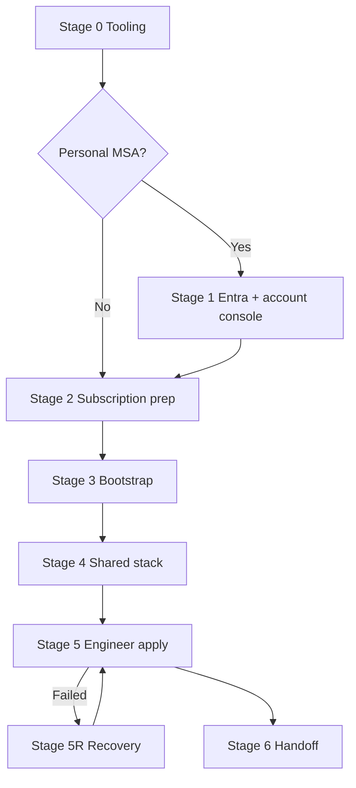

# Project B — deployment stages

**Start here** for a first-time Project B (Azure / Databricks) deploy. This guide is stage-based: find the stage that matches where you are, complete it, then move on.

For day-2 maintenance and deep reference, see the [Project B (Azure) runbook](./project-b-azure-runbook.md).

---

## Where am I?

| If you… | Go to |
|---------|--------|
| Have never installed Azure CLI / Terraform | [Stage 0](#stage-0--tooling) |
| Signed up with `@outlook.com` / personal MSA and cannot open the Databricks account console | [Stage 1](#stage-1--account--entra-personal-msa-only) |
| Have account console access but have not run Terraform yet | [Stage 2](#stage-2--subscription-prep) |
| Need remote state / bootstrap | [Stage 3](#stage-3--bootstrap--backends) |
| Bootstrap done; need shared metastore + access connector | [Stage 4](#stage-4--shared-stack) |
| Shared stack done; need first engineer sandbox | [Stage 5](#stage-5--first-engineer-apply) |
| `apply-b` failed partway (workspace exists, groups/warehouse failed) | [Stage 5R](#stage-5r--recover-from-failed-engineer-apply) |
| Engineer stack succeeded; hand off to junior | [Stage 6](#stage-6--handoff--verify) |



---

## Stage 0 — Tooling

**Prerequisites:** Linux or macOS admin shell; Azure subscription.

**Install:**

```bash
# Terraform >= 1.9 — see project-b-azure-runbook §1.1
terraform version

# Azure CLI — on CachyOS/Arch use pacman, NOT uv/pip
sudo pacman -S azure-cli make python
/usr/bin/az version

# Optional: regenerate seed data later
python3 --version   # >= 3.11
```

**Success looks like:** `terraform version`, `az version`, and `make help` all run without errors.

**If stuck:**

| Issue | Fix |
|-------|-----|
| Broken `~/.local/bin/az` shadows pacman install | Use `/usr/bin/az`; remove broken uv install |
| `az login` ModuleNotFoundError | Reinstall via `sudo pacman -S azure-cli` |

**Do not use** `databricks auth login` for Terraform — the Databricks provider uses **`az login`** only.

---

## Stage 1 — Account & Entra (personal MSA only)

**Skip** if you use a work/school `@company.com` tenant from day one.

**Prerequisites:** Azure subscription created with Outlook/Hotmail/Gmail-as-MSA.

Follow the full guide: **[Personal Azure account — Databricks setup](./personal-azure-databricks-setup.md)**

Summary:

1. Find **Tenant ID** and **`#EXT#` guest UPN** in Entra ID → Users.
2. Assign **Global Administrator** to the `#EXT#` user.
3. Enable **Access management for Azure resources** (Entra → Properties).
4. Optional: create a **Premium** bootstrap workspace in `uksouth` (often creates the only regional metastore).
5. Sign in to portal as `#EXT#` user, then open  
   `https://accounts.azuredatabricks.net/?tenant_id=<TENANT-ID>`.
6. Copy **Account ID** (UUID) from the account console username menu — **not** your subscription ID.

**Success looks like:** Full account console with sidebar (Workspaces, Catalog, User management). You are Databricks account admin.

**If stuck:** [Personal guide §9 troubleshooting](./personal-azure-databricks-setup.md#9-troubleshooting)

---

## Stage 2 — Subscription prep

**Prerequisites:** `az login` works; subscription selected.

```bash
az login --tenant "<tenant-id>"    # personal MSA: use tenant from Stage 1
az account set --subscription "<subscription-id-or-name>"
az account show --query "{name:name,id:id,tenant:tenantId,user:user.name}" -o table

for ns in Microsoft.Storage Microsoft.Databricks Microsoft.Authorization \
          Microsoft.Consumption Microsoft.Resources; do
  echo "Registering $ns ..."
  az provider register --namespace "$ns"
done

az provider show --namespace Microsoft.Storage --query registrationState -o tsv
# Must print: Registered
```

**Success looks like:** All providers `Registered` (wait 1–5 minutes if `Registering`).

**If stuck:** [Runbook §1.3](./project-b-azure-runbook.md#13-new-azure-subscriptions)

---

## Stage 3 — Bootstrap & backends

**Prerequisites:** Stage 2 complete.

```bash
make bootstrap-azure
# Record outputs: records/bootstrap-azure.outputs.txt
```

Then uncomment the `backend "azurerm"` blocks in:

- [`terraform/project-b-azure-shared/main.tf`](../../terraform/project-b-azure-shared/main.tf)
- [`terraform/project-b-azure-engineer/main.tf`](../../terraform/project-b-azure-engineer/main.tf)

Paste storage account name and resource group from bootstrap outputs.

**Success looks like:** `rg-sar-sandbox-tfstate` exists with a storage account; backends uncommented.

**If stuck:** Bootstrap created RG but no storage → providers still registering; retry after `Microsoft.Storage` is `Registered`.

---

## Stage 4 — Shared stack

**Prerequisites:** Stage 3 complete; Databricks account admin; account ID known.

### 4a. Create tfvars

```bash
cp terraform/project-b-azure-shared/example.tfvars \
   terraform/project-b-azure-shared/terraform.tfvars
```

Edit [`terraform/project-b-azure-shared/terraform.tfvars`](../../terraform/project-b-azure-shared/terraform.tfvars):

**Organizational tenant (no bootstrap workspace):**

```hcl
databricks_account_id = "<account-uuid>"
location              = "uksouth"
create_metastore      = true
```

**Personal MSA (bootstrap Premium workspace in Stage 1):**

```hcl
databricks_account_id   = "<account-uuid>"
location                = "uksouth"
create_metastore        = false
existing_metastore_id   = "<metastore-uuid-from-account-console>"
```

Find metastore UUID: account console → **Catalog** → click metastore → UUID in URL between `/data/` and `/configurations`. See [runbook §3.1](./project-b-azure-runbook.md#31-adopting-an-existing-metastore).

### 4b. Apply

```bash
make apply-b-shared
# Record: records/project-b-shared.outputs.txt
```

**Success looks like:** `metastore_id`, `access_connector_id`, `access_connector_principal_id` in outputs.

**If stuck:**

| Error | Fix |
|-------|-----|
| Metastore limit in region | Set `create_metastore = false` + `existing_metastore_id` |
| Account auth errors | Re-run `az login`; confirm account admin |

Export shared outputs for Stage 5:

```bash
make b-shared-env
# Copy/paste the export lines into your shell
```

---

## Stage 5 — First engineer apply

**Prerequisites:** Stage 4 complete; shared outputs available.

### 5a. Engineer tfvars (required)

```bash
cp terraform/project-b-azure-engineer/example.tfvars \
   terraform/project-b-azure-engineer/terraform.tfvars
```

Edit [`terraform/project-b-azure-engineer/terraform.tfvars`](../../terraform/project-b-azure-engineer/terraform.tfvars) — **all** fields required:

```hcl
engineer_id                   = "alex"
databricks_account_id         = "<same-as-shared>"
location                      = "uksouth"
metastore_id                  = "<from-shared-output>"
access_connector_id           = "<from-shared-output>"
access_connector_principal_id = "<from-shared-output>"
```

### 5b. Apply

```bash
make b-shared-env    # if not already exported
make apply-b ENGINEER=alex \
  METASTORE_ID="$METASTORE_ID" \
  ACCESS_CONNECTOR_ID="$ACCESS_CONNECTOR_ID" \
  ACCESS_CONNECTOR_PRINCIPAL_ID="$ACCESS_CONNECTOR_PRINCIPAL_ID"
```

**Duration:** 15–30 minutes typical (workspace provisioning + seed upload).

**Success looks like:** `records/project-b-alex.outputs.txt` with `databricks_workspace_url`, `catalog_name`, group names.

**If stuck:** [Stage 5R](#stage-5r--recover-from-failed-engineer-apply) or [runbook §3.5](./project-b-azure-runbook.md#35-recover-from-a-failed-engineer-apply)

---

## Stage 5R — Recover from failed engineer apply

**When:** `make apply-b` failed after creating storage, workspace, or catalog but before groups/grants/SQL warehouse succeeded.

**Do not delete** the `sar-<id>` workspace or resource group unless you intend a full reprovision.

### Checklist

1. **Pull latest repo** — account-level groups fix and engineer `databricks_account_id` are required.

2. **Engineer tfvars** — confirm [`terraform/project-b-azure-engineer/terraform.tfvars`](../../terraform/project-b-azure-engineer/terraform.tfvars) includes `databricks_account_id` (same UUID as shared).

3. **Delete workspace-local groups only** (if they exist from the failed run):  
   In the **`sar-<id>` workspace** → **Administration** → **Groups** → delete:
   - `sar-<id>-data-engineers`
   - `sar-<id>-analysts`
   - `sar-<id>-report-authors`  
   Do **not** delete account-level groups in the account console unless re-apply reports duplicate names.

4. **Optional:** delete stuck SQL warehouse `sar-<id>-sql` in workspace → **SQL** if re-apply errors on warehouse.

5. **Re-run apply:**

   ```bash
   az login --tenant "<tenant-id>"
   az account set --subscription "<subscription-id>"
   make b-shared-env
   make apply-b ENGINEER=alex \
     METASTORE_ID="$METASTORE_ID" \
     ACCESS_CONNECTOR_ID="$ACCESS_CONNECTOR_ID" \
     ACCESS_CONNECTOR_PRINCIPAL_ID="$ACCESS_CONNECTOR_PRINCIPAL_ID"
   ```

6. If grants fail with *Could not find principal*, wait 60 seconds and retry once.

**When to destroy instead:** only if you want a completely clean slate → [runbook §5.2](./project-b-azure-runbook.md#52-tear-down-one-engineer-stack) then re-run Stage 5.

---

## Stage 6 — Handoff & verify

**Prerequisites:** Stage 5 succeeded.

### 6a. Add junior to account group

Account console → **User management** → open **`sar-<id>-data-engineers`** → add the junior's Entra user.

Do **not** rely on workspace-local groups only — Unity Catalog uses account-level groups.

### 6b. Share outputs

From `records/project-b-<id>.outputs.txt`:

- `databricks_workspace_url`
- `catalog_name`
- `landing_external_location`
- `sql_warehouse_jdbc_url`
- Group names

### 6c. Smoke test

1. Open workspace URL → workspace loads.
2. **Catalog** → `sar_sandbox_<id>` exists.
3. **SQL** → warehouse exists (stopped until first query — expected).
4. Landing data under `raw/` in external location.

Point junior at [Project B engineer runbook](../developer/project-b/runbook.md).

**Optional cleanup:** set Entra **Access management for Azure resources** back to **No**; delete manual bootstrap workspace if unused.

---

## Stage checklist (copy per deploy)

```text
Stage 0  Tooling:                          [ ]
Stage 1  Personal account (if MSA):       [ ]  skipped — org tenant
Stage 2  Providers registered:            [ ]
Stage 3  bootstrap-azure + backends:      [ ]
Stage 4  apply-b-shared:                   [ ]
         create_metastore=false (MSA):     [ ]
Stage 5  engineer terraform.tfvars:        [ ]
         apply-b ENGINEER=___:             [ ]
Stage 5R Recovery (if needed):            [ ]
Stage 6  Junior in data-engineers group:   [ ]
         Smoke test passed:                [ ]
```

---

## Related docs

- [Project B (Azure) runbook](./project-b-azure-runbook.md) — full reference, day-2, troubleshooting
- [Personal Azure account — Databricks setup](./personal-azure-databricks-setup.md)
- [Portal navigation appendix](./project-b-azure-runbook.md#appendix-portal-navigation) — where to click in Azure/Databricks UI
