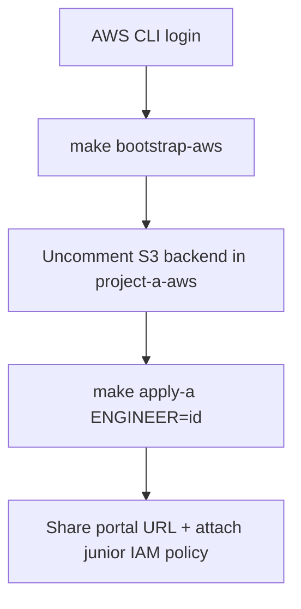
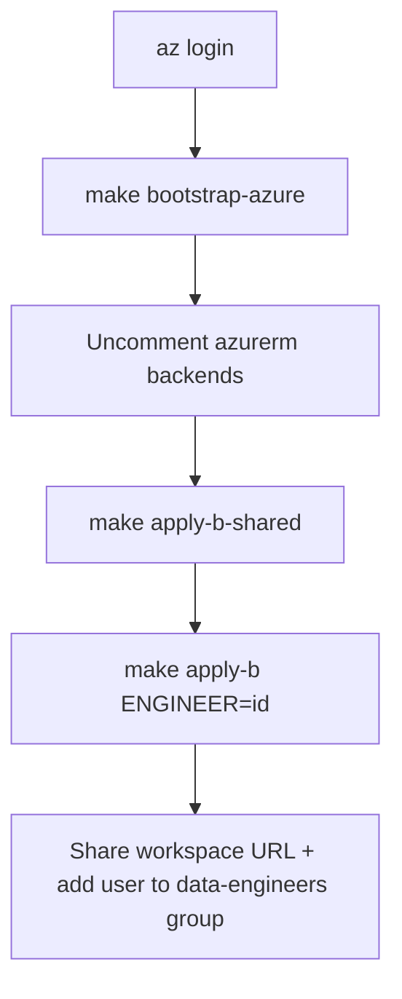

# Platform administrator runbook

Provisioning guide for the SAR sandbox foundational infrastructure. Junior engineers do **not** run these steps; they consume the outputs.

**Projects A and B are independent.** An engineer (or cohort) may work on only one. You only need credentials and tooling for the cloud(s) you are provisioning.

| Track | Project | Cloud | Jump to |
|-------|---------|-------|---------|
| **AWS only** | A — API & Document Request System | AWS | [§3 Project A (AWS)](#3-project-a--aws-only) |
| **Azure only** | B — Medallion lake & reporting | Azure / Databricks | [§4 Project B (Azure)](#4-project-b--azure-only) |
| Both | Full programme | AWS + Azure | Complete §3 then §4 (order does not matter) |

Shared tooling (Terraform, `make`, optional linters) is in [§2](#2-shared-tooling).

---

## 1. Choose your track

```text
Working on Project A only?  → Install §2 shared + §3.1 AWS tools → deploy §3
Working on Project B only?  → Install §2 shared + §4.1 Azure tools → deploy §4
Working on both?            → Install everything → deploy §3 and §4 independently
```

There is **no runtime dependency** between the AWS portal/API sandbox and the Azure Databricks lake. Sample SAR data for Project B is generated and seeded in-repo (`seed-data/`); it does not require a live Project A stack.

---

## 2. Shared tooling

Required for either track.

### 2.1 Terraform (`>= 1.9`) and Make

**Linux (official zip):**

```bash
VER=$(curl -fsSL https://checkpoint-api.hashicorp.com/v1/check/terraform \
  | python3 -c "import sys,json; print(json.load(sys.stdin)['current_version'])")
curl -fsSL "https://releases.hashicorp.com/terraform/${VER}/terraform_${VER}_linux_amd64.zip" -o /tmp/terraform.zip
sudo unzip -o /tmp/terraform.zip -d /usr/local/bin
terraform version
```

**macOS:** `brew tap hashicorp/tap && brew install hashicorp/tap/terraform`

```bash
# make + Python (seed data / local scripts)
sudo pacman -S make python          # Arch / CachyOS
# sudo apt install make python3     # Debian/Ubuntu
```

Providers download automatically on `terraform init`.

### 2.2 Optional lint / pre-commit

Not required to apply infrastructure.

```bash
# TFLint — brew install tflint  OR  install_linux.sh from terraform-linters/tflint
# Checkov / pre-commit — pipx or pip in a venv
pre-commit install   # if using .pre-commit-config.yaml
```

---

## 3. Project A — AWS only

Provision the Django portal, Keycloak, IAM baselines, and SSM integration seam. **Skip this entire section if the engineer is only on Project B.**

### 3.1 Install and authenticate (AWS)

| Tool | Why |
|------|-----|
| AWS CLI v2 | Bootstrap + Project A apply |
| `bash` + Python 3 | Staging the app artifact for S3 (no local Docker) |

Docker Engine is installed **on the EC2 sandbox host** by cloud-init and builds/runs the Compose stack there. You do **not** need Docker on your laptop to provision Project A.

**AWS CLI — Linux:**

```bash
curl -fsSL "https://awscli.amazonaws.com/awscli-exe-linux-x86_64.zip" -o /tmp/awscliv2.zip
unzip -o /tmp/awscliv2.zip -d /tmp
sudo /tmp/aws/install   # or user install to ~/.local
aws --version
```

**macOS:** `brew install awscli`

**Credentials:**

```bash
# Access keys (typical personal/sandbox account)
aws configure --profile aws_sandbox
# Access Key ID / Secret / region eu-west-2 / output json

export AWS_PROFILE=aws_sandbox
export AWS_DEFAULT_REGION=eu-west-2
aws sts get-caller-identity
```

Or SSO: `aws configure sso` then `aws sso login --profile <name>`.

### 3.2 Files to edit (AWS)

| File | Action |
|------|--------|
| [`terraform/bootstrap/aws/main.tf`](../../terraform/bootstrap/aws/main.tf) | Optional: `state_bucket_name` (must be **globally unique**), `aws_region` |
| [`terraform/project-a-aws/main.tf`](../../terraform/project-a-aws/main.tf) | After bootstrap: uncomment `backend "s3"` using bootstrap output snippet |
| [`terraform/project-a-aws/example.tfvars`](../../terraform/project-a-aws/example.tfvars) → `terraform.tfvars` | Recommended: `budget_alert_email`, `allowed_ingress_cidrs` |
| [`app/compose/.env.example`](../../app/compose/.env.example) → `.env` | Local Compose only (not required for cloud apply) |

Do **not** commit `terraform.tfvars` or `.env`.

Tell Terraform which profile to use via the environment (no code change needed):

```bash
export AWS_PROFILE=aws_sandbox
```

### 3.3 Deploy sequence (AWS)



```bash
export AWS_PROFILE=aws_sandbox   # or your profile name
make bootstrap-aws
cd terraform/bootstrap/aws && terraform output
# Paste backend_config_snippet into terraform/project-a-aws/main.tf, then:
terraform -chdir=terraform/project-a-aws init -migrate-state

make plan-a ENGINEER=alex
make apply-a ENGINEER=alex
cd terraform/project-a-aws && terraform workspace select alex && terraform output
```

| Output | Use |
|--------|-----|
| `portal_url` / `keycloak_url` | Access the sandbox UI |
| `lambda_execution_role_arn` | Attach to their Lambdas |
| `junior_developer_policy_arn` | Attach to their IAM user/role |
| `api_base_url_parameter` | They publish API Gateway URL here after Phase 1 |
| `keycloak_admin_password_ssm` | Mentor-only recovery |

**Post-provision (AWS):**

1. Attach `junior_developer_policy_arn` to the junior’s IAM principal.
2. Confirm Keycloak login (`officer.standard` / `officer.senior`, password `Password123!`).
3. Restrict `allowed_ingress_cidrs` if the host is internet-facing.
4. Confirm budget alerts if `budget_alert_email` was set.

### 3.4 Day-2 (AWS)

| Task | Command / notes |
|------|-----------------|
| Redeploy portal/Keycloak | [`app/compose/redeploy.sh`](../../app/compose/redeploy.sh) `<engineer_id> <instance_id> [region]` (uploads source zip; host runs `docker compose up --build`) |
| Live API mode | `SAR_API_MODE=live` after junior writes SSM API URL |
| JWT to API | `SAR_API_AUTH_ENABLED=true` (Phase 3) |
| Destroy engineer stack | `make destroy-a ENGINEER=alex` |

### 3.5 Checklist (AWS)

```text
Engineer ID: ________
bootstrap-aws + backend:     [ ]
apply-a:                     [ ]
  portal_url: ________________
  junior policy attached:    [ ]
Keycloak login verified:     [ ]
```

---

## 4. Project B — Azure only

Provision ADLS Gen2, seeded landing data, Databricks workspace, Unity Catalog, and SQL warehouse. **Skip this entire section if the engineer is only on Project A.**

### 4.1 Install and authenticate (Azure)

| Tool | Why |
|------|-----|
| Azure CLI | Bootstrap + Project B apply; Databricks provider uses `azure-cli` auth |
| Databricks account admin | Create/adopt Unity Catalog metastore (shared stack) |
| Python `>= 3.11` | `make seed-data` if you regenerate sample files |
| Optional: Databricks CLI | Day-2 workspace checks only |

**Azure CLI — Linux:** see [Install Azure CLI](https://learn.microsoft.com/en-us/cli/azure/install-azure-cli) for your distro (e.g. `pacman -S azure-cli`, or `uv tool install azure-cli`).

**macOS:** `brew install azure-cli`

```bash
az login
az account list -o table
az account set --subscription "<subscription-id-or-name>"
az account show --query '{name:name,id:id,tenant:tenantId}' -o table
```

Your identity must be able to create resource groups, storage, and Databricks workspaces. For `make apply-b-shared`, you also need **Databricks account admin**. Find the account ID in the Azure Databricks account console — required in tfvars.

**Optional Databricks CLI:**

```bash
brew install databricks   # or docs.databricks.com CLI install
databricks auth login --host https://accounts.azuredatabricks.net
```

### 4.2 Files to edit (Azure)

| File | Action |
|------|--------|
| [`terraform/bootstrap/azure/main.tf`](../../terraform/bootstrap/azure/main.tf) | Optional: `location`, `resource_group_name` |
| [`terraform/project-b-azure-shared/main.tf`](../../terraform/project-b-azure-shared/main.tf) | After bootstrap: uncomment `backend "azurerm"` |
| [`terraform/project-b-azure-engineer/main.tf`](../../terraform/project-b-azure-engineer/main.tf) | Uncomment backend; use a **distinct** state `key` from shared |
| [`terraform/project-b-azure-shared/example.tfvars`](../../terraform/project-b-azure-shared/example.tfvars) → `terraform.tfvars` | **Required:** `databricks_account_id`; optional metastore adopt + budget email |
| [`terraform/project-b-azure-engineer/example.tfvars`](../../terraform/project-b-azure-engineer/example.tfvars) | Or pass Makefile env: `METASTORE_ID`, `ACCESS_CONNECTOR_*` |

### 4.3 Deploy sequence (Azure)



```bash
make bootstrap-azure
cd terraform/bootstrap/azure && terraform output
# Paste snippets into project-b-azure-shared and project-b-azure-engineer backends

cp terraform/project-b-azure-shared/example.tfvars \
   terraform/project-b-azure-shared/terraform.tfvars
# Set databricks_account_id (and create_metastore / existing_metastore_id if needed)

make apply-b-shared
cd terraform/project-b-azure-shared && terraform output
# Save metastore_id, access_connector_id, access_connector_principal_id

make apply-b ENGINEER=alex \
  METASTORE_ID='...' \
  ACCESS_CONNECTOR_ID='...' \
  ACCESS_CONNECTOR_PRINCIPAL_ID='...'
```

If a Unity Catalog metastore **already exists** in the region:

```hcl
create_metastore      = false
existing_metastore_id = "<metastore-uuid>"
```

If the first engineer apply fails resolving the Databricks workspace host:

```bash
cd terraform/project-b-azure-engineer
terraform workspace select alex
terraform apply -target=module.workspace \
  -var="engineer_id=alex" \
  -var="metastore_id=$METASTORE_ID" \
  -var="access_connector_id=$ACCESS_CONNECTOR_ID" \
  -var="access_connector_principal_id=$ACCESS_CONNECTOR_PRINCIPAL_ID"
terraform apply \
  -var="engineer_id=alex" \
  -var="metastore_id=$METASTORE_ID" \
  -var="access_connector_id=$ACCESS_CONNECTOR_ID" \
  -var="access_connector_principal_id=$ACCESS_CONNECTOR_PRINCIPAL_ID"
```

Share: `databricks_workspace_url`, `catalog_name`, `landing_external_location`, `sql_warehouse_jdbc_url`, group names.

**Post-provision (Azure):**

1. Add the junior’s Entra ID user to `sar-<id>-data-engineers`.
2. Power BI licences/workspaces are **manual** — [power-bi.md](../project-b/power-bi.md).
3. Confirm budget alerts if configured.

### 4.4 Day-2 (Azure)

| Task | Command / notes |
|------|-----------------|
| Regenerate seed data | `make seed-data` then re-apply engineer stack |
| Destroy engineer stack | `make destroy-b ENGINEER=alex METASTORE_ID=... ...` |
| Shared metastore | Do **not** destroy while workspaces are still assigned |

### 4.5 Checklist (Azure)

```text
Engineer ID: ________
bootstrap-azure + backends:  [ ]
apply-b-shared:              [ ]
apply-b:                     [ ]
  workspace URL: _____________
  catalog: ___________________
  in data-engineers group:   [ ]
Power BI licence (Phase 4):  [ ]  (optional / later)
```

---

## 5. Makefile defaults

| Variable | Default | Used by |
|----------|---------|---------|
| `ENGINEER` | `demo` | Both tracks |
| `AWS_REGION` | `eu-west-2` | Project A only |
| `AZURE_LOCATION` | `uksouth` | Project B only |

---

## 6. Troubleshooting

### AWS (Project A)

| Symptom | Likely fix |
|---------|------------|
| `Unable to locate credentials` | `export AWS_PROFILE=...` and re-run `aws sts get-caller-identity` |
| S3 state bucket name taken | Change `state_bucket_name` in bootstrap AWS |
| Portal OIDC fails | Check nip.io hostname, Keycloak `/auth`, SSM `oidc-client-secret` |
| App artifact / stage fails | Ensure `scripts/stage-app-artifact.sh` is executable; Terraform stages via `data.external` during plan |
| Host containers not up | SSM into the instance and inspect `/var/log/sar-bootstrap.log`; Docker builds run on the EC2 host |

### Azure (Project B)

| Symptom | Likely fix |
|---------|------------|
| Metastore create fails (exists in region) | `create_metastore=false` + `existing_metastore_id` |
| Workspace provider host unknown | Two-phase apply with `-target=module.workspace` |
| `az` permission errors on `~/.azure` | Ensure that directory is owned by your user |

---

## 7. Related docs

- [Architecture overview](../architecture.md)
- [Project A engineer runbook](../project-a/runbook.md)
- [Project B engineer runbook](../project-b/runbook.md)
- [Seed data anomaly map](../mentor/anomaly-map.md) (mentor only)
