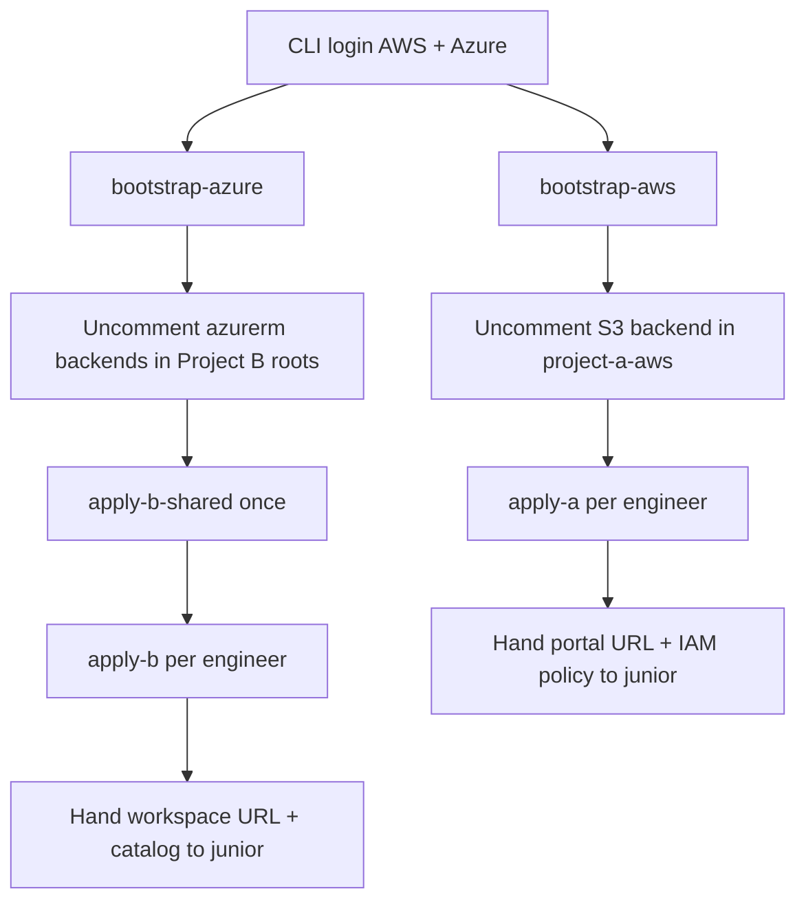

# Platform administrator runbook

End-to-end guide for provisioning the SAR sandbox foundational infrastructure. Junior engineers do **not** run these steps; they consume the outputs.

## 1. What you need before starting

| Requirement | Why |
|-------------|-----|
| Terraform `>= 1.9` | All root modules |
| AWS CLI authenticated to the **sandbox** account | Project A + AWS state bootstrap |
| Azure CLI (`az login`) with rights to create RGs/storage/Databricks workspaces | Project B |
| Databricks **account admin** on the Azure Databricks account | Unity Catalog metastore create/adopt |
| `make`, Docker (for packaging the app artifact) | `make package-app` / Compose builds |
| Optional: AWS Budgets + Azure Consumption Budget alert email | Cost guardrails |

Confirm identities:

```bash
aws sts get-caller-identity
az account show --query '{name:name,id:id,tenant:tenantId}' -o table
```

Find the Databricks account ID (Azure portal → Databricks account console, or account admin UI). You will put it in tfvars below.

---

## 2. Install CLIs and libraries

Commands below target **Linux (amd64)** and **macOS (Apple Silicon / Intel)**. Prefer package managers you already use (`apt`, `dnf`/`pacman`, `brew`). Pin versions where noted.

### 2.1 Verify what is already installed

```bash
terraform version    # need >= 1.9
aws --version
az version
docker --version
docker compose version
make --version
python3 --version    # need >= 3.11 for seed-data generator
```

### 2.2 Terraform (`>= 1.9`)

**Linux (official zip):**

```bash
VER=$(curl -fsSL https://checkpoint-api.hashicorp.com/v1/check/terraform \
  | python3 -c "import sys,json; print(json.load(sys.stdin)['current_version'])")
curl -fsSL "https://releases.hashicorp.com/terraform/${VER}/terraform_${VER}_linux_amd64.zip" -o /tmp/terraform.zip
sudo unzip -o /tmp/terraform.zip -d /usr/local/bin
terraform version
```

**macOS (Homebrew):**

```bash
brew tap hashicorp/tap
brew install hashicorp/tap/terraform
```

Providers (`hashicorp/aws`, `hashicorp/azurerm`, `databricks/databricks`) are downloaded automatically on `terraform init` — you do not install them separately.

### 2.3 AWS CLI v2

**Linux:**

```bash
curl -fsSL "https://awscli.amazonaws.com/awscli-exe-linux-x86_64.zip" -o /tmp/awscliv2.zip
unzip -o /tmp/awscliv2.zip -d /tmp
sudo /tmp/aws/install
aws --version
```

**macOS:**

```bash
brew install awscli
```

Configure the **sandbox** account (SSO example):

```bash
aws configure sso
# or: export AWS_PROFILE=sar-sandbox
aws sso login --profile sar-sandbox
aws sts get-caller-identity
```

### 2.4 Azure CLI

**Linux (distro packages):** follow [Install Azure CLI](https://learn.microsoft.com/en-us/cli/azure/install-azure-cli) for your distribution, e.g. Arch/`pacman`, Debian/`apt`, Fedora/`dnf`.

**macOS:**

```bash
brew install azure-cli
```

Sign in and select the sandbox subscription:

```bash
az login
az account list -o table
az account set --subscription "<subscription-id-or-name>"
az account show --query '{name:name,id:id,tenant:tenantId}' -o table
```

Project B Terraform uses `auth_type = "azure-cli"` for both `azurerm` and the Databricks provider. Your Azure identity must be able to create resource groups, storage, Databricks workspaces, and (for shared apply) act as a **Databricks account admin**.

### 2.5 Docker Engine + Compose plugin

Required to package and (on the EC2 host) run the Django / Keycloak stack. Locally you mainly need Docker so `make package-app` / image builds work if you iterate on Compose.

**Linux:** install Docker Engine from your distro or [docs.docker.com](https://docs.docker.com/engine/install/), then enable the service and your user:

```bash
sudo systemctl enable --now docker
sudo usermod -aG docker "$USER"   # log out/in afterwards
docker compose version
```

**macOS:** install [Docker Desktop](https://docs.docker.com/desktop/) or:

```bash
brew install --cask docker
```

### 2.6 Make and Python

```bash
# Linux examples
sudo pacman -S make python          # Arch / CachyOS
# sudo apt install make python3     # Debian/Ubuntu
# sudo dnf install make python3     # Fedora

# macOS
xcode-select --install             # provides make
brew install python
```

Python stdlib only is enough for `make seed-data` (`seed-data/generator/generate.py`). No pip packages are required for that script.

Optional — local Django portal development:

```bash
cd app/django-sar-portal
python3 -m venv .venv
source .venv/bin/activate
pip install -r requirements.txt
```

### 2.7 Optional tooling (lint / pre-commit)

Used by `make lint` and [`.pre-commit-config.yaml`](../../.pre-commit-config.yaml); not required to apply infrastructure.

```bash
# TFLint
curl -fsSL https://raw.githubusercontent.com/terraform-linters/tflint/master/install_linux.sh | bash
# or: brew install tflint
cd /path/to/repo && tflint --init   # downloads AWS/Azure rulesets from .tflint.hcl

# Checkov
pip install --user checkov
# or: brew install checkov

# pre-commit hooks
pip install --user pre-commit
pre-commit install
```

### 2.8 Optional — Databricks CLI

Not required for Terraform apply (auth is via Azure CLI). Useful for day-2 workspace checks:

```bash
# macOS / Linux via curl installer — see https://docs.databricks.com/aws/en/dev-tools/cli/install
brew install databricks            # macOS alternative
databricks -v
databricks auth login --host https://accounts.azuredatabricks.net
```

### 2.9 Sanity check

```bash
terraform version && aws --version && az version && docker compose version && make --version && python3 --version
aws sts get-caller-identity
az account show -o table
```

---

## 3. Files that need credentials or settings

Copy each `example.tfvars` to a **gitignored** `terraform.tfvars` (or pass `-var` / Makefile env). Do **not** commit secrets.

### 3.1 Credentials (environment / CLI — not committed)

| Mechanism | Used by | How to set |
|-----------|---------|------------|
| AWS credentials (`AWS_PROFILE`, env keys, or SSO) | `terraform/bootstrap/aws`, `terraform/project-a-aws` | `aws sso login` / `export AWS_PROFILE=...` |
| Azure CLI session | `terraform/bootstrap/azure`, both Project B roots | `az login` then `az account set --subscription <id>` |
| Databricks auth | Project B (via `auth_type = "azure-cli"`) | Same Azure CLI session; account must be Databricks account admin |

No `.env` is required for Terraform itself. App secrets for the EC2 host are generated by Terraform and stored in SSM.

Optional local Compose testing only:

| File | Purpose |
|------|---------|
| [`app/compose/.env.example`](../../app/compose/.env.example) → copy to `app/compose/.env` | Local Docker Compose (not used by cloud Terraform apply) |

### 3.2 Terraform settings you must edit

| File | Action | Required values |
|------|--------|-----------------|
| [`terraform/bootstrap/aws/main.tf`](../../terraform/bootstrap/aws/main.tf) | Optional: change defaults | `aws_region` (default `eu-west-2`), `state_bucket_name` (**must be globally unique** — change from `sar-sandbox-tfstate` if taken) |
| [`terraform/bootstrap/azure/main.tf`](../../terraform/bootstrap/azure/main.tf) | Optional | `location` (default `uksouth`), `resource_group_name` |
| [`terraform/project-a-aws/main.tf`](../../terraform/project-a-aws/main.tf) | After bootstrap: **uncomment and fill** `backend "s3"` | Bucket, region, DynamoDB lock table from bootstrap outputs |
| [`terraform/project-b-azure-shared/main.tf`](../../terraform/project-b-azure-shared/main.tf) | After bootstrap: **uncomment and fill** `backend "azurerm"` | RG, storage account, container from bootstrap outputs |
| [`terraform/project-b-azure-engineer/main.tf`](../../terraform/project-b-azure-engineer/main.tf) | After bootstrap: **uncomment and fill** `backend "azurerm"` | Same storage account; use a distinct `key` (e.g. `project-b-engineer/terraform.tfstate`) |
| [`terraform/project-b-azure-shared/example.tfvars`](../../terraform/project-b-azure-shared/example.tfvars) → `terraform.tfvars` | **Required** | `databricks_account_id`; optionally `create_metastore`, `existing_metastore_id`, `budget_alert_email`, `location`, `metastore_owner` |
| [`terraform/project-a-aws/example.tfvars`](../../terraform/project-a-aws/example.tfvars) → optional `terraform.tfvars` | Recommended | `budget_alert_email`, `allowed_ingress_cidrs` (restrict from `0.0.0.0/0` in shared sandboxes), `aws_region`, `monthly_budget_usd` |
| [`terraform/project-b-azure-engineer/example.tfvars`](../../terraform/project-b-azure-engineer/example.tfvars) → optional `terraform.tfvars` | Recommended | Shared outputs (`metastore_id`, `access_connector_*`), `budget_alert_email`, `location` |

`engineer_id` is normally passed via Makefile (`ENGINEER=alex`) rather than tfvars.

### 3.3 Makefile defaults (optional)

[`Makefile`](../../Makefile) top-level defaults:

| Variable | Default | Override |
|----------|---------|----------|
| `ENGINEER` | `demo` | `make apply-a ENGINEER=alex` |
| `AWS_REGION` | `eu-west-2` | `make apply-a AWS_REGION=eu-west-1` |
| `AZURE_LOCATION` | `uksouth` | `make apply-b-shared AZURE_LOCATION=westeurope` |

### 3.4 What you should not edit for routine deploys

| Path | Notes |
|------|-------|
| `terraform/modules/**` | Shared modules; change only if altering the platform design |
| `app/keycloak/realm-sar-sandbox.json` | Realm is imported as-is; client secret is patched at container start from SSM-generated value |
| `contracts/**` | Shared with juniors; coordinate before changing |
| `seed-data/out/**` | Regenerated with `make seed-data`; committed for stable Terraform uploads |

---

## 4. Deploy sequence



### Step A — Bootstrap remote state (once per cloud)

```bash
# Ensure AWS_PROFILE / subscription are correct first
make bootstrap-aws
cd terraform/bootstrap/aws && terraform output

make bootstrap-azure
cd terraform/bootstrap/azure && terraform output
```

Copy each `backend_config_snippet` into the commented `backend` blocks in:

- `terraform/project-a-aws/main.tf`
- `terraform/project-b-azure-shared/main.tf`
- `terraform/project-b-azure-engineer/main.tf` (change the state `key` so it does not collide with shared)

Then re-init with migration if you already applied locally:

```bash
terraform -chdir=terraform/project-a-aws init -migrate-state
terraform -chdir=terraform/project-b-azure-shared init -migrate-state
terraform -chdir=terraform/project-b-azure-engineer init -migrate-state
```

### Step B — Project A (per engineer)

```bash
make plan-a ENGINEER=alex
make apply-a ENGINEER=alex   # packages app + applies
cd terraform/project-a-aws && terraform workspace select alex && terraform output
```

Record and share with the junior / attach to their IAM principal:

| Output | Use |
|--------|-----|
| `portal_url` / `keycloak_url` | Access the sandbox UI |
| `lambda_execution_role_arn` | Attach to their Lambdas |
| `junior_developer_policy_arn` | Attach to their IAM user/role |
| `api_base_url_parameter` | They write their API Gateway URL here after Phase 1 |
| `keycloak_admin_password_ssm` | Mentor-only admin recovery |

Restrict ingress if the sandbox is not on a private network — set `allowed_ingress_cidrs` in Project A tfvars before apply.

### Step C — Project B shared (once per region)

```bash
cp terraform/project-b-azure-shared/example.tfvars \
   terraform/project-b-azure-shared/terraform.tfvars
# Edit databricks_account_id (and create_metastore / existing_metastore_id if needed)
```

If a Unity Catalog metastore **already exists** in the region:

```hcl
create_metastore      = false
existing_metastore_id = "<metastore-uuid>"
```

Apply:

```bash
make apply-b-shared
cd terraform/project-b-azure-shared && terraform output
```

Save:

- `metastore_id`
- `access_connector_id`
- `access_connector_principal_id`

### Step D — Project B per engineer

```bash
make apply-b ENGINEER=alex \
  METASTORE_ID='...' \
  ACCESS_CONNECTOR_ID='...' \
  ACCESS_CONNECTOR_PRINCIPAL_ID='...'
```

If the first apply fails because the Databricks workspace host is not ready yet:

```bash
cd terraform/project-b-azure-engineer
terraform workspace select alex
terraform apply -target=module.workspace \
  -var="engineer_id=alex" \
  -var="metastore_id=$METASTORE_ID" \
  -var="access_connector_id=$ACCESS_CONNECTOR_ID" \
  -var="access_connector_principal_id=$ACCESS_CONNECTOR_PRINCIPAL_ID"
terraform apply \
  -var="engineer_id=alex" \
  -var="metastore_id=$METASTORE_ID" \
  -var="access_connector_id=$ACCESS_CONNECTOR_ID" \
  -var="access_connector_principal_id=$ACCESS_CONNECTOR_PRINCIPAL_ID"
```

Share with the junior: `databricks_workspace_url`, `catalog_name`, `landing_external_location`, `sql_warehouse_jdbc_url`, group names.

### Step E — Post-provision admin tasks (manual)

1. **IAM** — Attach `junior_developer_policy_arn` to each junior’s IAM principal in the AWS sandbox.
2. **Databricks groups** — Add the junior’s Entra ID user to `sar-<id>-data-engineers` (and mentors to appropriate groups).
3. **Power BI** — Assign licences and workspace access; see [Power BI guide](../project-b/power-bi.md). Not automated by Terraform.
4. **Keycloak** — Confirm login with `officer.standard` / `officer.senior` (`Password123!`). Change test passwords if the sandbox is network-exposed.
5. **Budgets** — Confirm alert emails arrived (if `budget_alert_email` was set).

---

## 5. Per-engineer checklist (copy/paste)

```text
Engineer ID: ________
AWS workspace / apply-a:     [ ]
  portal_url: ________________
  junior policy attached:    [ ]
Azure apply-b:               [ ]
  workspace URL: _____________
  catalog: ___________________
  added to data-engineers:   [ ]
Power BI licence (if Phase 4): [ ]
```

---

## 6. Day-2 operations

| Task | Command / notes |
|------|-----------------|
| Redeploy portal/Keycloak app only | [`app/compose/redeploy.sh`](../../app/compose/redeploy.sh) `<engineer_id> <instance_id> [region]` |
| Flip portal to live API | Update host env `SAR_API_MODE=live` (via redeploy / SSM + compose) after junior publishes API URL to SSM |
| Enable JWT forwarding | `SAR_API_AUTH_ENABLED=true` for Phase 3 |
| Regenerate seed data | `make seed-data` then re-apply Project B engineer stack |
| Destroy one engineer (AWS) | `make destroy-a ENGINEER=alex` |
| Destroy one engineer (Azure) | `make destroy-b ENGINEER=alex METASTORE_ID=... ...` |
| Do **not** destroy shared metastore while engineer workspaces are attached | Drain assignments first |

---

## 7. Troubleshooting

| Symptom | Likely fix |
|---------|------------|
| S3 state bucket name already taken | Change `state_bucket_name` in bootstrap AWS and re-apply bootstrap |
| Databricks metastore create fails (already exists in region) | Set `create_metastore=false` and `existing_metastore_id` |
| Project B engineer provider host unknown | Two-phase apply with `-target=module.workspace` (Step D) |
| Portal up but OIDC fails | Check `HOSTNAME` / nip.io DNS, Keycloak `/auth` path, and that client secret in realm matches SSM `oidc-client-secret` |
| `make apply-a` fails on missing `/tmp/sar-app-build/app.tar.gz` | Run `make package-app` (also invoked automatically by `apply-a`) |
| Budget resources not created | `budget_alert_email` is empty — set it in tfvars |

---

## 8. Related docs

- [Architecture overview](../architecture.md)
- [Project A engineer runbook](../project-a/runbook.md)
- [Project B engineer runbook](../project-b/runbook.md)
- [Seed data anomaly map](../mentor/anomaly-map.md) (mentor only)
