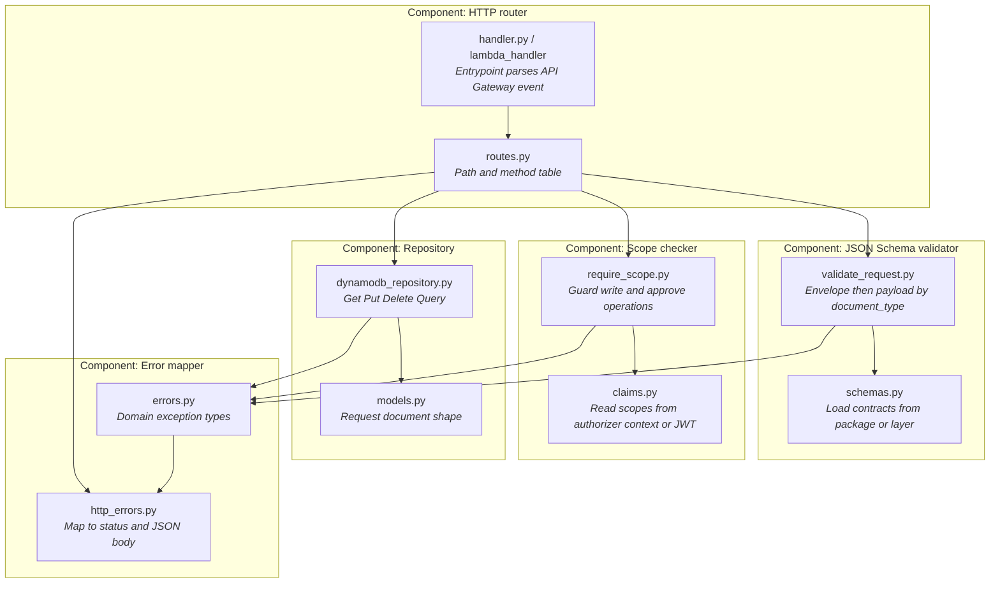

# Project A — Target C4 (Code)

**Audience:** mentors / reference for juniors (optional depth).  
**Zoom:** illustrative **code elements** inside the Lambda components. Keep this light — C4 is a sketch of modules, not a full class browser.

C4 shows **classes / modules / packages** that implement C3 components. Juniors’ real names may differ; the shape should match.

## Notes for reviewers

- File names are **examples** — accept equivalent structure in the junior’s repo.  
- Prefer one deployable Lambda (or a small set) over a large microservice farm for this sandbox.  
- Contracts come from [`project-deployments/project-a/lambda/contracts/`](../../project-deployments/project-a/lambda/contracts/) — they ship in the function zip; do not silently diverge from the portal.
- CloudWatch logging uses the provided [`logging_helpers.py`](../../project-deployments/project-a/lambda/logging_helpers.py) (`log_event`, `logger`); prefer that over ad-hoc `print`.  
- **Zoom back out:** [C3](./c3-component.md) · [C2](./c2-container.md) · [C1](./c1-system-context.md)
