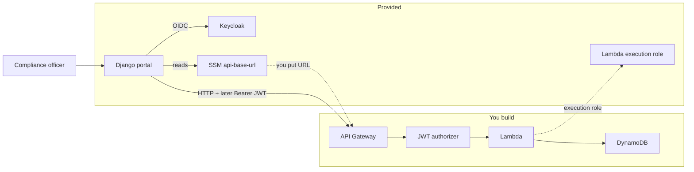

# Project A — Junior Engineer Guide: AWS API & Document Request System

Welcome to Project A! This guide will walk you step-by-step through building a secure, serverless backend on AWS. You will be working closely with your mentor, moving phase by phase.

While this guide gives you the exact requirements, the implementation details (like which buttons to click in the AWS Console or which exact code syntax to use) are yours to research.

**Note:** This project is **standalone**. You do not need to know Azure or have access to Project B to complete it.

Related docs you will use along the way:


| Doc                                                                      | When                                 |
| ------------------------------------------------------------------------ | ------------------------------------ |
| [C4 skeleton](./c4-skeleton.md) | Phase 1 diagrams; update in Phase 2+ |
| [C1–C4 targets](./c1-system-context.md) | Mentor reference diagrams (C1; see also C2/C3/C4 siblings) |
| `[contracts/](../../contracts/)`                                         | Phase 2 validation                   |
| [Portal API client](../../app/django-sar-portal/sar/services/sar_api.py) | Expected HTTP paths                  |
| [Architecture overview](../architecture.md)                              | Big picture / build boundary         |
| [Keycloak realm notes](../../app/keycloak/README.md)                     | Roles, clients, scopes               |


---


## 1. Why are we doing this?

Abstract talks about APIs, identity management, and cloud resilience can be incredibly hard to follow when you are early in your career. This programme is designed to build your architectural vocabulary and engineering confidence by mirroring real-world production patterns in a safe, small sandbox.

**Design principles you will experience as you work:**

- **Separation of Concerns:** You are focusing entirely on building the **API and data backend**. The frontend web portal and the identity provider (Keycloak) are already provided for you.
- **Incremental Complexity:** We won't overwhelm you. Each phase adds exactly one major new concept: Reachability → State & Data → Security → Resilience.
- **Concept First:** You will always read the "Theory & Context" section before you start coding, so you understand *why* we build things this way.
- **Mentorship over Scripts:** You will be given clear goals and "data contracts," but you get to choose exactly how to write the code to meet them.

---


## 2. The Business Scenario


### What is a SAR?

Subject Access Requests (SARs) are a legal compliance requirement. If a user asks a company, "What data do you hold on me?", the company must provide it.

Compliance officers in our fictional company use an internal web portal to request specific data payloads about users from internal engineering teams.


| Document type          | What the compliance officer is asking for                   |
| ---------------------- | ----------------------------------------------------------- |
| `user_profile_summary` | A basic snapshot of the user's profile attributes           |
| `user_activity_report` | An extract of the user's activity and usage history         |
| `user_consent_log`     | A history of when the user opted in or out of data tracking |


### How your project fits in

The compliance officers log into a Django web portal. That portal needs to send their requests to a backend API and database. **You are building that backend API.** You will use AWS Lambda, API Gateway, and DynamoDB, and eventually secure it using Keycloak tokens.

### Primary use cases

1. Officer signs in to the SAR Compliance Portal (OIDC via Keycloak — already wired).
2. Officer creates a SAR request for a document type; the payload must match the JSON Schema for that type.
3. Officer lists, views, updates, and deletes requests through the same API.
4. Senior officer can perform actions that need the `sar:approve` scope (Phase 3+).
5. You (and the portal) can tell whether the API is healthy via `GET /health`.


### The actors


| Actor                       | How they appear in the sandbox                                               |
| --------------------------- | ---------------------------------------------------------------------------- |
| Standard compliance officer | Portal login `officer.standard` / `Password123!` → role `standard_officer`   |
| Senior compliance officer   | Portal login `officer.senior` / `Password123!` → role `senior_officer`       |
| You (the engineer)          | AWS IAM principal with the junior developer policy; build and deploy the API |


Log in via the **portal** (`portal_url`), not the Keycloak admin console. Admin console is a different realm and those officer users will not work there.

---


## 3. Your Sandbox Environment

Your mentor provisions a dedicated AWS sandbox just for you (`engineer_id` = your short ID, e.g. `alex`). Ask them for the Terraform outputs (or read them if you have access).

### Useful outputs to keep in your notes


| Output                        | Use                                                                              |
| ----------------------------- | -------------------------------------------------------------------------------- |
| `portal_url`                  | Day-to-day UI                                                                    |
| `keycloak_url`                | Identity / issuer base (`…/auth`)                                                |
| `hostname`                    | Host used in OIDC issuer URLs                                                    |
| `lambda_execution_role_arn`   | Attach to **every** Lambda you create                                            |
| `junior_developer_policy_arn` | Mentor attaches this to **your** IAM user/role                                   |
| `api_base_url_parameter`      | Exact SSM name for your API base URL (usually `/sar-sandbox/<you>/api-base-url`) |


Stay in the region your mentor used (typically `eu-west-2`).

### What is provided for you


| Component                       | Purpose                                                                           |
| ------------------------------- | --------------------------------------------------------------------------------- |
| **Django SAR portal**           | Ready-made UI; already handles Keycloak OIDC login                                |
| **Keycloak**                    | Realm `sar-sandbox`, test users/roles, clients `sar-portal` + `sar-api`           |
| **IAM Lambda execution role**   | `lambda_execution_role_arn` — attach to every function                            |
| **IAM junior developer policy** | Lets you create `sar-<you>-`* resources (mentor attaches it)                      |
| **SSM parameter**               | `/sar-sandbox/<you>/api-base-url` — you publish your API base URL here            |
| **JSON Schema contracts**       | `[contracts/](../../contracts/)` — shared by portal forms and your API validation |
| **Optional log archive bucket** | For CloudWatch export experiments; not required to finish Project A               |


### What you will build

- AWS Lambda function(s) — business logic  
- API Gateway — HTTP front door to Lambda  
- DynamoDB table(s) — persistent SAR request state  
- JWT authorizer / scope checks — Phase 3 security  
- Resilience behaviour and the availability write-up — Phase 4




### Guardrails

- Prefix almost everything with `sar-<you>-` (e.g. `sar-alex-hello`, `sar-alex-requests`).
- Do **not** rebuild Django or Keycloak from scratch.
- Do **not** create long-lived IAM users/access keys for yourself; use the provided policy + Lambda role.
- If you get `AccessDenied`, check spelling and the `sar-<you>-` prefix — a permissions boundary blocks escalation and off-prefix resources.
- If the portal host was **auto-stopped** overnight, ask your mentor to start the EC2 instance before demos.

---


## 4. How you integrate with the existing stack

You rarely change portal or Keycloak code. You integrate through **seams**.

### 4.1 Portal ↔ your API (SSM)

1. Deploy API Gateway and note the **invoke base URL** (no `/health` suffix).
2. Publish it to SSM:

```bash
aws ssm put-parameter \
  --name "/sar-sandbox/<you>/api-base-url" \
  --value "https://xxxxxxxx.execute-api.eu-west-2.amazonaws.com/Default" \
  --type String \
  --overwrite
```

1. Ask your mentor to set `SAR_API_MODE=live` on the sandbox host and recreate the Django container. Until then the portal uses an in-memory **mock** API.

**REST vs HTTP API — what to put in SSM**


| API type          | Value in SSM                                                                                                           |
| ----------------- | ---------------------------------------------------------------------------------------------------------------------- |
| **HTTP API** (v2) | `https://{api-id}.execute-api.{region}.amazonaws.com` (often no stage if `$default`)                                   |
| **REST API** (v1) | **Must include the stage:** `https://{api-id}.execute-api.{region}.amazonaws.com/{stage}` e.g. `…/Default` or `…/prod` |


Do **not** append `/health` in SSM — the portal adds paths itself. If `curl "$URL/health"` returns 403 `Forbidden` on a REST API, you almost certainly omitted the stage (API Gateway treated `health` as a stage name).

Verify before asking for `live` mode:

```bash
curl -sS -i "$URL/health"
# expect HTTP 200 and JSON
```

On the portal home page after `live` mode:

- Header badge should show `API: live`
- Under the title, `API health:` should show your Lambda message (not a red error)


### 4.2 Paths the portal expects

The portal client is `[sar/services/sar_api.py](../../app/django-sar-portal/sar/services/sar_api.py)`. Keep these paths (or change the client **with mentor agreement** only):


| Portal method              | HTTP (live mode)        |
| -------------------------- | ----------------------- |
| `health()`                 | `GET /health`           |
| `list_requests()`          | `GET /requests`         |
| `get_request(id)`          | `GET /requests/{id}`    |
| `create_request(body)`     | `POST /requests`        |
| `update_request(id, body)` | `PUT /requests/{id}`    |
| `delete_request(id)`       | `DELETE /requests/{id}` |


Do not rename the Python methods — the views depend on them.

### 4.3 Portal ↔ Keycloak (already done)

OIDC login is configured. In Phase 3 the portal can send the officer’s access token as `Authorization: Bearer …` when your mentor sets `SAR_API_AUTH_ENABLED=true`.

### 4.4 Your API ↔ Keycloak (Phase 3)

- **Issuer:** `https://<hostname>/auth/realms/sar-sandbox`
- **Audience:** `sar-api`
- **Scopes:** `sar:read`, `sar:write`, `sar:approve` (senior)

What table(s) does the junior need to implement in Phase 2? It isn't clear. There are three document types that can be requested, but the tasks are only related to requests in general. Are there separate tables and APIs that should be created?

### 4.5 Contracts

Validate write bodies using `[contracts/](../../contracts/)`:

- Envelope: `sar-request-envelope.schema.json`
- Payload by `document_type`: matching `user-*.schema.json`

The portal already builds forms from these schemas. Invalid bodies → clear **4xx** (typically 400).

### 4.6 IAM

- Attach `lambda_execution_role_arn` to your functions.
- Create only `sar-<you>-*` resources your junior policy allows.

---


## 5. Getting Started Checklist

Before you write any Phase 1 code:

1. [ ] Mentor has run `make apply-a ENGINEER=<you>` (or equivalent) and shared outputs.
2. [ ] Junior developer policy is attached to **your** IAM principal.
3. [ ] You can open `portal_url`, log in as `officer.standard` / `Password123!`, and see the home page (API may still say `mock`).
4. [ ] AWS CLI works: `aws sts get-caller-identity`.
5. [ ] You can read this repo’s `contracts/` folder and the portal client linked above.
6. [ ] You have skimmed the [C4 skeleton](./c4-skeleton.md).

---


## 6. Phased Delivery Plan


### Phase 1: Foundation & The C4 Model

**Theory & Context:** Before we build, we must plan. The C4 model is a standard way to draw architecture diagrams so everyone understands the system. Next, we introduce **Serverless** and **APIs**. Instead of renting a server that runs 24/7, we use AWS Lambda, which only runs (and bills us) when someone triggers it. API Gateway acts as the "front door," taking an HTTP web request from the Django portal and triggering your Lambda code. Finally, we use **Systems Manager (SSM)**. Instead of hard-coding your API's URL into the Django portal's source code, you save your URL in SSM. The portal looks up that parameter to find you. This is a crucial configuration best practice!

**Your Goals:**

1. Complete the Context and Container diagrams in the [C4 skeleton](./c4-skeleton.md).
2. Write a simple Python Lambda named `sar-<you>-hello` and attach `lambda_execution_role_arn`.
3. Create an API Gateway with `GET /health` pointing to your Lambda. Return JSON like `{"status":"ok","message":"Hello from <you>"}`.
4. Save the API **base URL** (include REST **stage** if applicable — see §4.1) into SSM `/sar-sandbox/<you>/api-base-url`.
5. Confirm `curl "$URL/health"` returns 200, then ask your mentor to flip the portal to `SAR_API_MODE=live` and recreate Django.

**You are done when:**

- [ ] Context + Container diagrams submitted / reviewed.
- [ ] Portal header shows `API: live`.
- [ ] Portal home shows **API health:** with your custom message (not mock, not a red error).
- [ ] Resources named `sar-<you>-…`.

---


### Phase 2: Core API & Dynamic State

**Theory & Context:**

RESTful APIs use standard HTTP methods (`POST` to create, `GET` to read, `PUT` to update, `DELETE` to remove) to manage resources.

However, AWS Lambda functions are **stateless**. When they finish running, they forget everything. To permanently save the SAR requests, we must use an external database: DynamoDB.

Finally, if the frontend sends bad data, the backend will crash or store garbage. We use **data contracts** (JSON Schemas) to validate incoming requests. If the data doesn't match the contract, your API must reject it immediately.

**Data model (important):** There is **one** business resource — a **SAR request** — not three separate APIs or three required tables.

The three document types (`user_profile_summary`, `user_activity_report`, `user_consent_log`) are values of `document_type` on the **same** request envelope. They change how you **validate** the nested `payload` field, not which URL or table you use.

| Layer | What to build |
|-------|----------------|
| **API** | One CRUD API for requests (`/requests`, `/requests/{id}`) plus existing `/health` |
| **DynamoDB** | **One table** is the expected design (e.g. `sar-<you>-requests`), storing full request documents |
| **Validation** | Always validate the envelope schema; then validate `payload` against the schema for that `document_type` |

Example item shape (conceptual):

```json
{
  "request_id": "…",
  "document_type": "user_consent_log",
  "subject": { "…": "…" },
  "requestor": { "…": "…" },
  "priority": "medium",
  "status": "submitted",
  "created_at": "…",
  "payload": { "/* fields from user-consent-log.schema.json */" }
}
```

You do **not** need `/user-profile-summaries`, `/user-activity-reports`, etc., unless you and your mentor explicitly agree to diverge from the portal client (not recommended).

A single-table DynamoDB design with extra access patterns (GSIs) is fine if you justify it; three physical tables (one per document type) is **not** required and usually makes Phase 2 harder without benefit.

**Your Goals:**

1. Create **one** DynamoDB table named `sar-<you>-requests` (or similar). Choose a primary key (typically `request_id`); add a GSI only if you need a query pattern beyond get-by-id / scan-or-query-for-list.
2. Expand API Gateway + Lambda for the portal paths in §4.2 (`/requests`, `/requests/{id}`). Keep `GET /health` working.
3. On `POST`/`PUT`: validate **envelope** + **payload for `document_type`**. Unknown `document_type` or schema mismatch → `4xx`.
4. Suggested status values (align with envelope enums): e.g. `submitted`, `in_progress`, `pending_approval`, `fulfilled`, `rejected`, `cancelled`.
5. Update your C4 **Component** diagram (router → validator → repository → DynamoDB).
6. Exercise end-to-end from the portal for **more than one** document type: create → list → open → edit → delete (mentor keeps `SAR_API_MODE=live`).

**You are done when:**

- [ ] Full CRUD works via the portal against the live API for multiple document types.
- [ ] Invalid envelopes/payloads return 4xx with a useful error body.
- [ ] Data survives Lambda cold starts (DynamoDB).
- [ ] Component diagram updated.

---


### Phase 3: Security & Identity

**Theory & Context:**

Right now, anyone on the internet with your API URL could create a SAR request. We need to secure it using **Zero Trust** architecture.

When an officer logs into Keycloak, they receive a JSON Web Token (JWT) — a digital ID badge. It contains **scopes** (what they are allowed to do, like `sar:read` or `sar:approve`). Your API Gateway needs an **authorizer** that checks this badge *before* the request reaches Lambda.

**Your Goals:**

1. Research OAuth 2.0 / OIDC and JWT claims: Issuer (`iss`), Audience (`aud`), expiry (`exp`), scopes.
2. Configure an API Gateway JWT authorizer (or Lambda authorizer) against:
  - Issuer `https://<hostname>/auth/realms/sar-sandbox`
  - Audience `sar-api`
3. Map scopes to operations, for example:
  - `sar:read` — list / get
  - `sar:write` — create / update / delete
  - `sar:approve` — senior-only transitions (e.g. approve / reject) if you model them
4. Demonstrate `officer.standard` cannot do senior-only actions; `officer.senior` can.
5. Ask your mentor to set `SAR_API_AUTH_ENABLED=true` on the host so the portal sends Bearer tokens; retest while logged in.
6. Confirm anonymous `curl` without a token gets **401/403**.

Do not reconfigure Keycloak clients unless your mentor agrees — the realm already defines `sar-api` and the scopes.

**You are done when:**

- [ ] Unauthenticated API calls fail.
- [ ] Authenticated portal flows still work with JWT mode on.
- [ ] Scope differences between standard and senior are demonstrable.
- [ ] Short write-up: which claims you trust and why.

---


### Phase 4: Resilience & Error Handling

**Theory & Context:**

In cloud engineering, things *will* break. Databases time out, networks drop. Professional APIs fail gracefully. Instead of a blank screen, your API must catch errors and return standard HTTP status codes (e.g. 404 Not Found, 500 Internal Error, 503 Service Unavailable) so the frontend can show a polite message.

**Your Goals:**

1. Introduce at least two controlled failure scenarios (examples: wrong DynamoDB table name, forced timeout, not-found vs validation vs conflict).
2. Catch exceptions and return clean JSON errors like `{"error":"...","code":"..."}` with the correct HTTP status (400 / 401 / 403 / 404 / 409 / 500 / 503 as appropriate).
3. Verify the portal shows a useful `SarApiError` / message instead of an opaque crash where you control the API.
4. **Theory exercise:** Write a short paper (length defined by mentor) on **AWS Lambda intra-region availability**: what AWS provides out of the box, what you still design for (retries, idempotency, multi-AZ data), and what this sandbox does *not* prove (e.g. multi-region active-active).

**You are done when:**

- [ ] Failure scenarios demoed with expected status codes.
- [ ] Portal shows understandable errors for those cases.
- [ ] Availability write-up submitted.
- [ ] C4 diagrams still match what you shipped.

---


## 7. Working with your mentor


| You                                                  | Mentor                                                                             |
| ---------------------------------------------------- | ---------------------------------------------------------------------------------- |
| Research and implement each phase                    | Clarifies “why”; reviews diagrams and demos                                        |
| Publish API URL to SSM                               | Flips `SAR_API_MODE` / `SAR_API_AUTH_ENABLED` on the EC2 host and recreates Django |
| Demo via portal + test users                         | Attaches junior IAM policy; recovers Keycloak admin if needed                      |
| Ask before changing contracts or portal method names | Approves contract / client changes                                                 |


---


## 8. Quick Troubleshooting Guide


| Problem                                       | What to check                                                                                                        |
| --------------------------------------------- | -------------------------------------------------------------------------------------------------------------------- |
| Portal still says mock / badge is `API: mock` | Exact URL in SSM? Mentor set `SAR_API_MODE=live` and recreated Django?                                               |
| `API: live` but no healthy message            | Look for a red **API health** error under the title. Test `curl -i "$URL/health"`.                                   |
| `403 Forbidden` from API / portal health      | REST API: did SSM include the **stage** (`…/Default`)? Auth still `NONE` on `/health` until Phase 3? Wrong base URL? |
| `AccessDenied` creating AWS resources         | Name starts with `sar-<you>-`? Junior policy attached to your principal? Lambda using `lambda_execution_role_arn`?   |
| Portal login fails / loops                    | Use portal login, not Keycloak admin. Escalate PKCE / redirect URI issues to mentor.                                 |
| Validation always fails                       | Compare portal JSON to `contracts/`; check `document_type`.                                                          |
| 401/403 after Phase 3 with portal logged in   | Mentor set `SAR_API_AUTH_ENABLED=true`? Token audience `sar-api`? Issuer host correct?                               |
| Host / portal unreachable                     | Instance auto-stopped? Ask mentor to start it.                                                                       |


