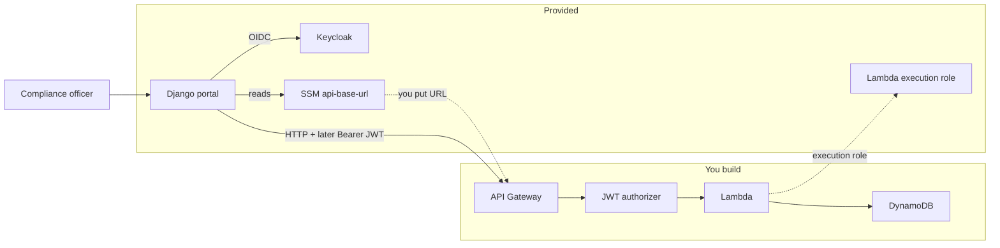

# Project A — Engineer guide

**AWS API & Document Request System**

This is the main guide for junior engineers on Project A. Follow it phase by phase with your mentor. Implementation details (console clicks, exact SDK calls) are yours to research — the contracts, integration seams, and acceptance criteria are fixed.

Project A is **standalone**. You do not need Azure or Project B to complete it.

---

## 1. Why this project exists

The programme builds architectural vocabulary and confidence by mirroring production patterns in a small sandbox. Abstract talks about APIs, identity, and resilience land better when you have shipped something that uses them.

**Design principles you will feel as you work:**

| Principle | What it means here |
|-----------|-------------------|
| Separation of concerns | The portal and Keycloak are provided. You build the **API and data plane**, not a web app from scratch. |
| Incremental complexity | Each phase adds one major concern (reachability → state → security → resilience). |
| Concept first | Read the “concepts” section of a phase before coding. |
| Mentorship over scripts | You get clear contracts and seams; you choose how to implement them. |

---

## 2. Business scenario and use cases

### Scenario

Compliance officers manage internal **Subject Access Requests (SARs)**. They use a web portal to request specific data payloads from internal teams:

| Document type | Meaning |
|---------------|---------|
| `user_profile_summary` | Snapshot of subject profile attributes |
| `user_activity_report` | Activity / usage extract for the subject |
| `user_consent_log` | Consent history for the subject |

Officers authenticate via the organisation’s identity provider. The portal talks to a backend API. That API is what you build on AWS (Lambda + API Gateway + DynamoDB), secured later with Keycloak JWTs.

### Primary use cases

1. **Officer signs in** to the SAR Compliance Portal (OIDC via Keycloak — already wired).
2. **Officer creates a SAR request** choosing a document type; the portal posts a payload that must match the JSON Schema for that type.
3. **Officer lists / views / updates / deletes** requests through the same API.
4. **Senior officer** can perform actions that need the `sar:approve` scope (Phase 3+).
5. **Operations** can tell whether the API is healthy (`GET /health`) and whether failures return honest HTTP status codes (Phase 4).

### Actors

| Actor | How they appear in the sandbox |
|-------|--------------------------------|
| Standard compliance officer | Keycloak user `officer.standard` → role `standard_officer` |
| Senior compliance officer | Keycloak user `officer.senior` → role `senior_officer` |
| You (engineer) | AWS IAM principal with the junior developer policy; builds and deploys the API |

---

## 3. Your environment (what already exists)

Your mentor provisions a **per-engineer** AWS sandbox (`engineer_id` = your short id, e.g. `alex`). Ask them for the Terraform outputs below (or read them yourself if you have access).

### Provided for you

| Component | Purpose |
|-----------|---------|
| **Django SAR portal** | Boilerplate UI for create/list/detail. Already does OIDC login with Keycloak. |
| **Keycloak** | Realm `sar-sandbox`, clients `sar-portal` + `sar-api`, test users and roles. |
| **IAM Lambda execution role** | Attach this role to **every** Lambda you create (`lambda_execution_role_arn`). |
| **IAM junior developer policy** | Attached to **your** IAM user/role by your mentor — lets you create `sar-<you>-*` resources. |
| **SSM parameter** `/sar-sandbox/<you>/api-base-url` | Integration seam: you publish your API Gateway base URL here. |
| **JSON Schema contracts** | [`contracts/`](../../contracts/) — portal forms and your API validation share these. |
| **Optional log archive bucket** | For CloudWatch export experiments; not required to finish Project A. |

### You deliberately do **not** get (you build these)

- Lambda functions  
- API Gateway HTTP API  
- DynamoDB tables  
- JWT authorizer / scope checks  
- Resilience behaviour and the availability write-up  



### Naming and guardrails

- Prefix almost everything with `sar-<you>-` (functions, tables, APIs, logs).  
- Stay in the sandbox region your mentor used (typically `eu-west-2`).  
- Do **not** rebuild Django or Keycloak from scratch.  
- Do **not** create long-lived IAM users/access keys for yourself; use the policy + execution role provided.  
- A permissions boundary limits escalation — if a create fails with AccessDenied, check naming and that you used the provided Lambda role.

### Test users (portal login only)

Login via the **portal** (`portal_url`), not the Keycloak admin console.

| Username | Password | Role | Scopes (Phase 3) |
|----------|----------|------|------------------|
| `officer.standard` | `Password123!` | `standard_officer` | `sar:read`, `sar:write` |
| `officer.senior` | `Password123!` | `senior_officer` | + `sar:approve` |

---

## 4. How you integrate with the existing stack

You rarely change portal or Keycloak code. You integrate through **seams**:

### 4.1 Portal ↔ your API (SSM)

1. Deploy API Gateway and note the **invoke base URL** (no trailing path), e.g.  
   `https://abcdef.execute-api.eu-west-2.amazonaws.com`
2. Publish it:

```bash
aws ssm put-parameter \
  --name "/sar-sandbox/<you>/api-base-url" \
  --value "https://xxxxxxxx.execute-api.eu-west-2.amazonaws.com" \
  --type String \
  --overwrite
```

**REST vs HTTP API base URL**

| API type | What to put in SSM |
|----------|-------------------|
| **HTTP API** (v2) | `https://{api-id}.execute-api.{region}.amazonaws.com` (often no stage segment if `$default`) |
| **REST API** (v1) | Must include the **stage**: `https://{api-id}.execute-api.{region}.amazonaws.com/{stage}` e.g. `.../Default` or `.../prod` |

Do **not** append `/health` in SSM — the portal adds paths itself. If `curl "$URL/health"` returns 403 with `ForbiddenException` on a REST API, you almost certainly omitted the stage (API Gateway treated `health` as a stage name).

3. Ask your mentor to set `SAR_API_MODE=live` on the sandbox host (Compose `.env`) and recreate the Django container. Until then the portal uses an in-memory **mock** API.
The portal client lives at [`app/django-sar-portal/sar/services/sar_api.py`](../../app/django-sar-portal/sar/services/sar_api.py). It expects broadly:

| Method | HTTP (live mode) |
|--------|------------------|
| `health()` | `GET /health` |
| `list_requests()` | `GET /requests` |
| `get_request(id)` | `GET /requests/{id}` |
| `create_request(body)` | `POST /requests` |
| `update_request(id, body)` | `PUT /requests/{id}` |
| `delete_request(id)` | `DELETE /requests/{id}` |

Keep those paths (or update the client **with mentor agreement** if you choose different routes). Do not rename the Python methods — views depend on them.

### 4.2 Portal ↔ Keycloak (already done)

OIDC login is configured. In Phase 3 the portal can send the officer’s access token as `Authorization: Bearer …` when `SAR_API_AUTH_ENABLED=true` (mentor flips this after your authorizer works).

### 4.3 Your API ↔ Keycloak (Phase 3)

- **Issuer:** `https://<hostname>/auth/realms/sar-sandbox`  
- **Audience:** `sar-api` (resource client in the realm)  
- **Scopes:** `sar:read`, `sar:write`, `sar:approve`  
- Validate JWT on API Gateway (JWT authorizer or Lambda authorizer — your choice after research).

### 4.4 Contracts

Validate request bodies using [`contracts/`](../../contracts/):

- Envelope: `sar-request-envelope.schema.json`  
- Payload by `document_type`: the matching `user-*.schema.json`  

The portal already builds forms from these schemas. Your API must reject invalid bodies with a clear **4xx** (typically 400).

### 4.5 IAM

- Attach **`lambda_execution_role_arn`** to your functions (includes permissions suitable for DynamoDB/logs in the sandbox pattern).  
- Create resources only under names your junior policy allows (`sar-<you>-*`).

---

## 5. Getting started checklist

Before Phase 1 coding:

1. Mentor has run `make apply-a ENGINEER=<you>` and shared outputs.  
2. Junior developer policy is attached to **your** IAM principal.  
3. You can open `portal_url`, log in as `officer.standard`, and see the home page (API may still say `mock`).  
4. AWS CLI works for you (`aws sts get-caller-identity`).  
5. You have cloned/accessed this repo so you can read `contracts/` and the portal client.  
6. Skim [C4 skeleton](./c4-skeleton.md) — Phase 1 includes Context + Container diagrams.

Useful outputs to keep in your notes:

| Output | Use |
|--------|-----|
| `portal_url` | Day-to-day UI |
| `keycloak_url` | Realm / token issuer base (`…/auth`) |
| `lambda_execution_role_arn` | Lambda execution role |
| `api_base_url_parameter` | Exact SSM name for your URL |
| `hostname` | Host used in issuer URLs |

---

## 6. Phased delivery

### Phase 1 — Foundation & C4 model

**Concepts:** C4 Context/Container; deploying compute behind an HTTP façade; configuration as integration (SSM) rather than hard-coding URLs in the UI.

**Goals**

- Map the system in C4 (Context + Container).  
- Deploy a Hello World Lambda behind API Gateway.  
- Wire the provided portal so the home page shows **your** health response.

**Key tasks**

1. Complete Context + Container diagrams ([C4 skeleton](./c4-skeleton.md)).  
2. Create Lambda `sar-<you>-hello` (Python recommended) using `lambda_execution_role_arn`.  
3. Create an **HTTP API** (API Gateway) with at least `GET /health` → Lambda.  
   Response shape suggestion: `{"status":"ok","message":"Hello from <you>"}` (JSON).  
4. Put the API **base URL** into SSM (`api_base_url_parameter`).  
5. Mentor sets `SAR_API_MODE=live`; confirm the portal home page shows your message (not the mock string).

**Integration with existing infra**

- Portal `health()` → `GET {ssm_base}/health`.  
- No DynamoDB or JWT yet.

**Done when**

- [ ] Context + Container diagrams submitted / reviewed.  
- [ ] `curl` (or browser) hits `GET /health` on your API successfully.  
- [ ] Portal home in **live** mode shows your health payload.  
- [ ] Resources named `sar-<you>-…`.

---

### Phase 2 — Core API & dynamic state

**Concepts:** REST resource design; externalising state (DynamoDB); schema-driven validation; shared contracts between UI and API.

**Goals**

- Full CRUD for SAR requests.  
- Persist state in DynamoDB.  
- Validate bodies against the JSON Schema for the envelope + document type.

**Key tasks**

1. Design routes consistent with the portal client (`/requests`, `/requests/{id}`).  
2. Create DynamoDB table(s) named `sar-<you>-…` (single-table or one table — justify in your notes).  
3. Implement POST / GET list / GET by id / PUT / DELETE.  
4. On write, validate with `contracts/` (envelope + payload schema for `document_type`).  
5. Keep `GET /health` working.  
6. Update the C4 **Component** diagram for the Lambda internals.  
7. Exercise end-to-end from the portal: create → list → open → edit → delete (mentor keeps `SAR_API_MODE=live`).

**Suggested status values** (align with envelope schema enums): e.g. `submitted`, `in_progress`, `pending_approval`, `fulfilled`, `rejected`, `cancelled`.

**Integration with existing infra**

- Portal create/list/detail forms already emit contract-shaped JSON — your API must accept that shape.  
- No authorizer required yet (API may still be open within the sandbox); do not skip securing it in Phase 3.

**Done when**

- [ ] CRUD works via portal against live API.  
- [ ] Invalid payloads return 4xx with a useful error body.  
- [ ] Data survives Lambda cold starts (DynamoDB).  
- [ ] Component diagram updated.

---

### Phase 3 — Security & identity

**Concepts:** OAuth 2.0 / OIDC; JWT structure (iss, aud, exp, scope); Zero Trust at the edge (API Gateway); role vs scope.

**Goals**

- API Gateway rejects unauthenticated calls.  
- Scope checks: standard vs senior officer capabilities.  
- Portal sends the bearer token when mentor enables JWT mode.

**Key tasks**

1. Research OAuth 2.0 auth code flow (what the portal already does) vs what the **API** must verify.  
2. Configure API Gateway JWT authorizer (or Lambda authorizer) against Keycloak:  
   - Issuer `https://<hostname>/auth/realms/sar-sandbox`  
   - Audience `sar-api`  
3. Map scopes to operations, for example:  
   - `sar:read` — list/get  
   - `sar:write` — create/update/delete  
   - `sar:approve` — senior-only transitions (e.g. approve / reject) if you model them  
4. Confirm `officer.standard` cannot do senior-only actions; `officer.senior` can.  
5. Ask mentor to set `SAR_API_AUTH_ENABLED=true` on the host; retest portal flows while logged in.  
6. Confirm anonymous `curl` without a token gets **401/403**.

**Integration with existing infra**

- Do not reconfigure Keycloak clients unless mentor-approved; realm already has `sar-api` audience and scopes.  
- Token is available to the portal client from the OIDC session when JWT mode is on.

**Done when**

- [ ] Unauthenticated API calls fail.  
- [ ] Authenticated portal flows still work with JWT mode on.  
- [ ] Scope differences between standard and senior are demonstrable.  
- [ ] Short write-up: which claims you trust and why.

---

### Phase 4 — Resilience & error handling

**Concepts:** Failing gracefully; mapping internal faults to HTTP status codes; what “availability” means for Lambda in one region.

**Goals**

- Deliberate failure paths return accurate, stable HTTP codes.  
- Portal surfaces errors usefully (status + message).  
- Theoretical note on Lambda intra-region availability.

**Key tasks**

1. Introduce at least two controlled failure scenarios (examples):  
   - DynamoDB throttling / forced timeout / missing table  
   - Malformed auth after authorizer (if applicable)  
   - Upstream validation vs not-found vs conflict  
2. Standardise error JSON (e.g. `{"error":"...","code":"..."}`) and map to 400 / 401 / 403 / 404 / 409 / 500 / 503 as appropriate.  
3. Confirm the portal shows failures via `SarApiError` (messages on create/list/etc.) rather than opaque 502s where you control the API.  
4. Write a short paper (mentor-defined length) on **AWS Lambda intra-region availability**: what AWS provides, what you still design for (retries, idempotency, multi-AZ data), and what this sandbox does *not* prove.

**Integration with existing infra**

- Prefer improving API behaviour over rewriting Django.  
- Optional: emit structured logs to CloudWatch; archive bucket exists if you want to explore export.

**Done when**

- [ ] Failure scenarios demoed with expected status codes.  
- [ ] Portal shows understandable errors for those cases.  
- [ ] Availability write-up submitted.  
- [ ] C4 diagrams still match the shipped system.

---

## 7. Working rhythm with your mentor

| You | Mentor |
|-----|--------|
| Research and implement each phase | Clarifies “why”, reviews diagrams and demos |
| Publish API URL to SSM | Flips `SAR_API_MODE` / `SAR_API_AUTH_ENABLED` on the host |
| Use portal + test users to demo | Attaches junior IAM policy; recovers Keycloak admin if needed |
| Ask before changing contracts or portal method names | Approves contract changes |

If the sandbox host was **auto-stopped** overnight, ask your mentor to start the EC2 instance again before demos.

---

## 8. Reference links

| Doc | When |
|-----|------|
| [C4 skeleton](./c4-skeleton.md) | Phase 1 (Context/Container), Phase 2+ (Components) |
| [Architecture overview](../architecture.md) | Big picture / build boundary |
| [`contracts/`](../../contracts/) | Phase 2 validation |
| [Portal SAR API client](../../app/django-sar-portal/sar/services/sar_api.py) | Path and method expectations |
| [Keycloak realm notes](../../app/keycloak/README.md) | Roles, clients, scopes |
| Platform admin runbook | Mentor-only provisioning (you normally do not run this) |

---

## 9. Quick “stuck?” checks

| Symptom | Check |
|---------|--------|
| Portal still says mock Hello | SSM URL set? Mentor set `SAR_API_MODE=live` and recreated Django? |
| `API: live` but no healthy message | Look for a red **API health** error under the title. `403` usually means API Gateway is denying the call (IAM auth, missing public route, wrong base URL/stage, or authorizer). Test `curl "$URL/health"` from your laptop. |
| Portal login loops / instant return | Mentor/platform PKCE and redirect URI config — escalate |
| AccessDenied creating AWS resources | Policy attached? Name starts with `sar-<you>-`? |
| 401/403 after Phase 3 with portal | `SAR_API_AUTH_ENABLED=true`? Token audience `sar-api`? Logged in? |
| Validation always fails | Compare portal JSON to `contracts/`; check `document_type` |
| Host unreachable | Instance stopped by schedule? Security group / VPN? |
